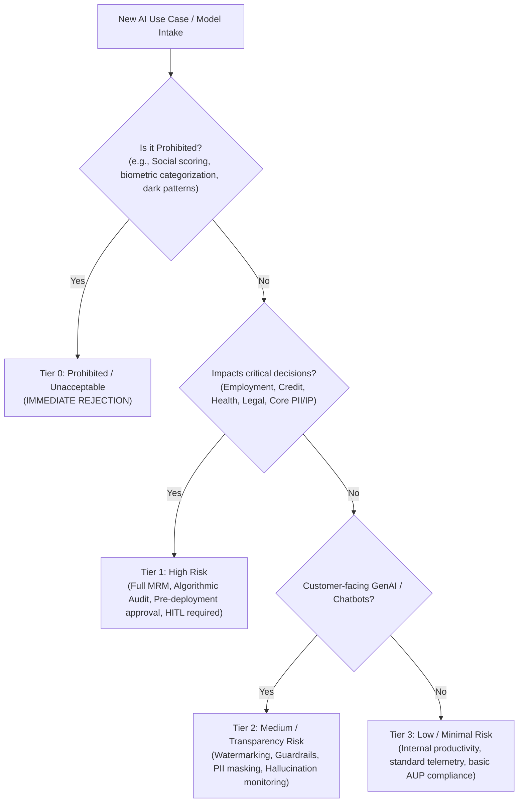

# Enterprise AI Governance, Ethics & Compliance Reference Framework

## 1. Global AI Regulatory & Standards Alignment

| Standard / Regulation | Scope & Core Requirements | Enterprise Implementation Impact |
| :--- | :--- | :--- |
| **EU AI Act** | Risk-based classification (Unacceptable, High, Specific/Transparency, Minimal). Strict conformity assessments for High-Risk systems. | Mandatory risk classification for all use cases, technical documentation, human oversight (HITL), cybersecurity, and post-market monitoring. |
| **NIST AI RMF 1.0** | Framework across 4 core functions: **GOVERN**, **MAP**, **MEASURE**, **MANAGE**. | Operational framework for risk identification, bias measurement, robustness testing, and governance accountability across the AI lifecycle. |
| **ISO/IEC 42001:2023** | International standard for Artificial Intelligence Management Systems (AIMS). | Process-level certification, management review, risk assessment methodologies, and continuous improvement of AI controls. |
| **US Executive Order 14110 & OMB M-24-10** | Safety, security, privacy, and equity standards for federal and enterprise AI applications. | Safety red-teaming, watermarking/provenance of synthetic content, algorithmic impact assessments. |

---

## 2. Enterprise AI Risk Classification Matrix



---

## 3. The 3-Lines-of-Defense Governance Model

```
[ Line 1: Business Units & Development Squads ]
  - Day-to-day risk identification, data lineage capture, unit guardrails, prompt engineering, initial testing.
        |
        v
[ Line 2: Enterprise AI Risk, Ethics & Compliance Committee (MRM) ]
  - Policy formulation, independent model validation, bias & safety audits, vendor assessments, release sign-off.
        |
        v
[ Line 3: Internal Audit & External Regulators ]
  - Independent assurance, governance audit, regulatory compliance verification, board reporting.
```

---

## 4. Enterprise Model Lifecycle & Inventory Management

1. **Intake & Classification**:
   - Register model in centralized Enterprise Model Registry (e.g., MLflow, AWS SageMaker Model Registry, Azure AI Studio, Custom Portal).
   - Document: Business Owner, Data Lineage, Intended Purpose, Model Architecture, Risk Tier (Tier 0–3).

2. **Pre-Deployment Model Validation Gate**:
   - **Fairness & Bias Testing**: Disparate impact ratio, demographic parity across protected attributes.
   - **Safety & Robustness**: Automated red-teaming (jailbreaking, prompt injection, data extraction attacks).
   - **Hallucination & Grounding**: RAG faithfulness score, answer relevance, citation recall.
   - **Explainability & Interpretability**: SHAP/LIME feature attributions or chain-of-thought audit trails.

3. **In-Production Continuous Telemetry & Guardrails**:
   - Real-time PII/PHI scrubbing (Presidio/Custom Guardrails).
   - Input/Output toxicity, brand safety, and prompt injection filters (NeMo Guardrails, Llama Guard).
   - Drift detection (data drift, concept drift, embedding shift).

4. **Annual Recertification & Decommissioning / Kill-Switch**:
   - Mandatory annual recertification for all Tier 1 & Tier 2 models.
   - Automated Kill-Switch: Immediate traffic redirection to deterministic fallback/rules engine upon breach of safety thresholds.

---

## 5. Enterprise AI Core Policies Checklist

- [ ] **Enterprise Acceptable Use Policy (AUP)**: Prohibits pasting confidential IP/PII into unapproved consumer LLMs.
- [ ] **Shadow AI Mitigation & Enterprise Sandbox Policy**: Provides secure enterprise LLM gateways to eliminate reliance on external unauthorized tools.
- [ ] **Third-Party AI & Vendor Risk Policy**: Assesses vendor training data rights, zero-retention SLAs, indemnity clauses, and SOC2/ISO 42001 certifications.
- [ ] **Intellectual Property & Copyright Policy**: Establishes provenance tracking, synthetic media disclosures, and commercial licensing validation for foundation models.
- [ ] **Human-in-the-Loop (HITL) Policy**: Defines specific critical decision thresholds requiring mandatory human review before execution.
