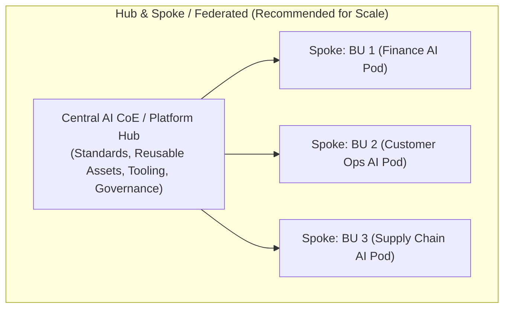

# Enterprise AI Target Operating Models (TOM) Reference Guide

## 1. Overview & Operating Model Archetypes

Choosing the right AI Operating Model is critical to balance centralized governance and standards with decentralized business agility.



### Archetype Comparison

| Model Archetype | Best Suited For | Key Advantages | Critical Risks / Bottlenecks | Autonomy Level |
| :--- | :--- | :--- | :--- | :--- |
| **Centralized AI CoE** | Early-stage maturity (Levels 1–2), regulated environments, small data teams | Strong governance, unified tooling, talent pooling, cost control | Becomes a delivery bottleneck; detached from business domain context | Low (Central team builds all) |
| **Decentralized / Embedded** | High maturity organizations with independent tech-savvy BUs | Rapid business-specific iteration, deep domain knowledge | Siloed tooling, technical debt, duplicate models, inconsistent governance | High (Each BU builds independently) |
| **Federated / Hub-and-Spoke** *(Recommended)* | Mid-to-Large Enterprises scaling AI across multiple business units | Reusable platforms, shared governance, fast domain delivery | Requires strong leadership alignment and clear RACI boundaries | Balanced (Hub sets rails, Spokes build) |
| **AI Platform-as-a-Product** | AI-native enterprises and tech-driven giants (Levels 4–5) | Extreme self-service scale, decoupled releases, continuous innovation | High platform engineering capex; requires high developer maturity | Autonomous Self-Service |

---

## 2. Enterprise AI RACI Matrix

| Role / Function | AI Strategy & Vision | Use Case Prioritization | Architecture & Platform | Model Dev & Training | Governance & Compliance | Deployment & MLOps | Change & Adoption |
| :--- | :---: | :---: | :---: | :---: | :---: | :---: | :---: |
| **Chief AI Officer (CAIO) / CDAO** | **A / R** | **A** | **C** | **I** | **A** | **I** | **A** |
| **AI Steering Committee** | **C** | **A** | **I** | **I** | **A** | **I** | **C** |
| **Business Unit / Product Leads** | **C** | **R** | **I** | **C** | **I** | **I** | **R** |
| **Central AI CoE / Lead Architect** | **R** | **C** | **A / R** | **C** | **R** | **A / R** | **C** |
| **Embedded AI / ML Pod Engineers** | **I** | **C** | **C** | **A / R** | **C** | **R** | **I** |
| **Enterprise AI Risk & Ethics Board** | **C** | **I** | **C** | **I** | **A / R** | **C** | **I** |
| **Change Management / HR / AI Guild** | **I** | **I** | **I** | **I** | **I** | **I** | **A / R** |

*R = Responsible, A = Accountable, C = Consulted, I = Informed*

---

## 3. Organizational Structure & Team Topologies

### 1. Executive AI Council (Quarterly)
- **Members**: CEO, CAIO/CDAO, CIO, CTO, CRO/Legal, BU Presidents.
- **Mandate**: Capital allocation, strategic priority endorsement, high-risk model approval, policy ratification.

### 2. Enterprise AI Center of Excellence (CoE) & Platform Team
- **Core Roles**:
  - Head of Enterprise AI / CAIO
  - AI Solution & Infrastructure Architect
  - Lead MLOps / LLMOps Engineer
  - Enterprise AI Governance & Safety Lead
  - AI Product Manager (Platform)

### 3. Business Unit AI Delivery Pods (Spokes)
- **Pod Structure (Cross-functional Squad)**:
  - Product Owner / Business SME (from Business Unit)
  - Applied Data Scientist / Machine Learning Engineer
  - Prompt / Context Engineer (GenAI / Agentic focus)
  - Full-Stack / Integration Engineer
  - Change & Adoption Champion

---

## 4. Scaling Archetype Evolution Roadmap

```
Level 1 (Centralized CoE)  -->  Level 2 (CoE + Embedded Liaisons)  -->  Level 3 (Federated Hub-and-Spoke)  -->  Level 4 (Platform-as-a-Product + Citizen AI)
```
1. **Initiation (Months 1–6)**: Establish Central CoE to standardize tooling, LLM gateways, vector DBs, and core policies.
2. **Acceleration (Months 6–18)**: Seed Business Units with AI Champions; establish Federated Pods; Hub provides SDKs and pipelines.
3. **Institutionalization (Months 18–36)**: Self-service AI platform with automated guardrails, low-code sandbox for citizen developers, continuous deployment pipelines.
