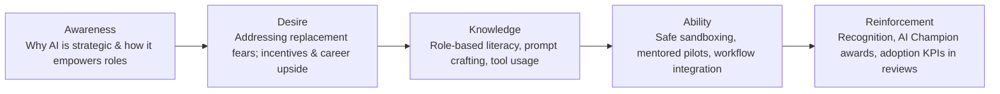

# Enterprise Organizational Change Management & AI Literacy Blueprint

## 1. ADKAR Change Management Model Applied to Enterprise AI Adoption

---

## 2. 4-Tier Persona-Based AI Literacy Curriculum

| Persona Track | Target Audience | Core Learning Objectives | Delivery Format | Key Competency Milestones |
| :--- | :--- | :--- | :--- | :--- |
| **Track 1: Executive & Leadership** | C-suite, SVPs, VPs, Business Unit Heads | Strategic AI value drivers, risk/governance basics, capital allocation, ethical responsibilities | Half-day executive workshops + quarterly briefings | AI Strategy Scorecard creation, risk appetite definition |
| **Track 2: Product & Business Leaders** | Product Managers, Operations Managers, Business Analysts | Identifying high-value use cases, prompt engineering for workflows, evaluating model outputs, human-in-the-loop design | 2-week modular hybrid bootcamps + sandbox clinics | AI Product Requirements Document (PRD) with feasibility score |
| **Track 3: Knowledge Workers & Citizen AI** | General workforce, Marketing, Finance, HR, Customer Support, Legal | Safe enterprise LLM usage, prompt crafting best practices, critical review/verification of AI outputs, data privacy rules | 4-hour self-paced LMS modules + weekly "Prompt Labs" | Enterprise AI "Driver's License" certification |
| **Track 4: Technical & Engineering** | Software Engineers, Data Engineers, Architects, DevOps | LLM fine-tuning, RAG architectures, Vector DBs, MLOps/LLMOps pipelines, security/red-teaming, agentic orchestration | 6-week intensive engineering track + hands-on hackathons | Production-grade AI microservice deployment |

---

## 3. Cultural Shift & Fear-to-Augmentation Strategy

### 1. Reframe AI from "Job Replacement" to "Cognitive Multiplier"
- Launch the **"Centaur Worker"** mindset: humans + AI outperform humans alone or AI alone.
- Guarantee non-punitive transition: time saved by AI automation is reinvested into higher-value strategic domain work, creative problem-solving, and cross-functional leadership.

### 2. The Enterprise AI Champion Network (AI Guild)
- Recruit 1–2 enthusiastic champions per 50 business employees.
- Champions run monthly "Lunch & Learn" demos, surface departmental pain points to the Central CoE, and test early prototype features.

### 3. "Safe-to-Fail" Enterprise Sandbox Innovation
- Deploy a governed enterprise sandbox where employees can freely experiment with approved foundation models without data leak risks.
- Host quarterly internal AI hackathons with executive prize pools and fast-track funding to production for winning prototypes.

---

## 4. Measuring Organizational Adoption & Engagement

- **Literacy Completion Rate**: % of target employees certified by track (Target: >90% within 90 days of rollout).
- **Active AI Adoption Rate**: Monthly Active Users (MAU) / Daily Active Users (DAU) across approved enterprise AI tools.
- **Workflow Penetration**: % of standard departmental operating procedures leveraging integrated AI assistance.
- **Employee Sentiment & Trust Index**: Quarterly surveys assessing psychological safety, perceived productivity boost, and confidence in AI reliability.
