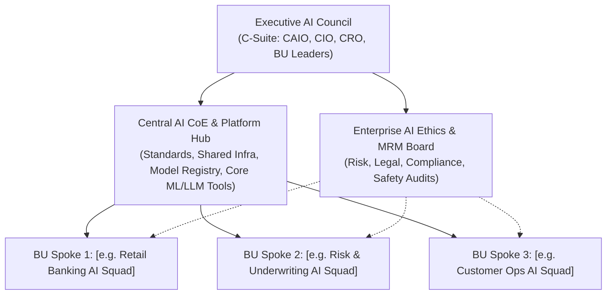
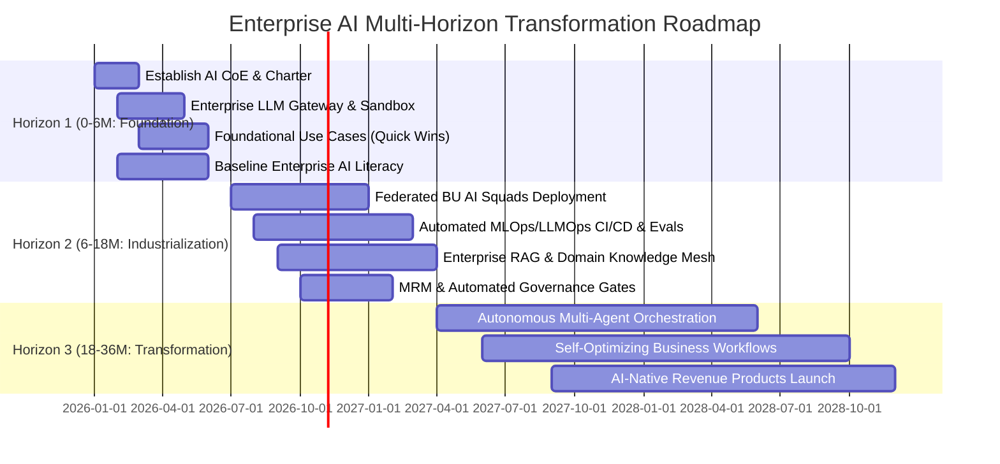

# Enterprise AI Strategy, Capability Transformation & Governance Roadmap

## Document Overview
- **Enterprise / Organization**: `[Client / Organization Name]`
- **Industry / Sector**: `[e.g., Financial Services, Healthcare, Retail, Manufacturing]`
- **Target Operating Horizon**: `[e.g., 2026 – 2028 (36 Months)]`
- **Lead Executive Sponsor**: `[e.g., Chief AI Officer (CAIO) / Chief Digital Officer]`
- **Document Version**: `1.0 (Executive Baseline)`

---

## 1. Executive Summary & Strategic Ambition

### 1.1 The North Star AI Vision
> `[Synthesize the 3-year transformation vision: How AI shifts the organization from reactive operations to predictive, automated, and AI-native market leadership.]`

### 1.2 Enterprise AI Ambition Matrix
| Ambition Tier | Strategic Focus | Target Business Impact | Representative Capabilities | Target Allocation (%) |
| :--- | :--- | :--- | :--- | :---: |
| **Tier 1: Core Optimization** | Efficiency & Cost Reduction | 20–40% operational cost reduction | Document processing, code generation, customer service routing | `[e.g., 40%]` |
| **Tier 2: Expanded Capabilities** | Revenue Growth & Speed | 2x turnaround time, higher win rates | Hyper-personalized customer journeys, predictive maintenance | `[e.g., 40%]` |
| **Tier 3: Business Model Transformation** | Market Disruption & New Products | Net new AI-driven product revenue | Autonomous agentic advisory, self-optimizing supply chains | `[e.g., 20%]` |

---

## 2. Enterprise AI Target Operating Model (TOM) & RACI

### 2.1 Selected Operating Model Archetype
- **Selected Archetype**: `[Centralized CoE | Federated Hub-and-Spoke | Platform-as-a-Product]`
- **Architectural Justification**: `[Detail why this model matches current organizational maturity, scale, and compliance constraints]`

### 2.2 Enterprise Governance & Delivery Topology

### 2.3 Executive RACI Matrix
| Function / Role | Strategy & Capital | Use Case Intake | Platform & Infra | Model Dev & Tuning | Governance & Risk | MLOps & Ops | Change & Training |
| :--- | :---: | :---: | :---: | :---: | :---: | :---: | :---: |
| **Chief AI Officer (CAIO)** | **A / R** | **A** | **C** | **I** | **A** | **I** | **A** |
| **AI Steering Council** | **C** | **A** | **I** | **I** | **A** | **I** | **C** |
| **Business Unit Presidents / Leads** | **C** | **R** | **I** | **C** | **I** | **I** | **R** |
| **Central AI CoE & Platform Lead** | **R** | **C** | **A / R** | **C** | **R** | **A / R** | **C** |
| **Embedded AI / ML Squads** | **I** | **C** | **C** | **A / R** | **C** | **R** | **I** |
| **Model Risk & Ethics Committee** | **C** | **I** | **C** | **I** | **A / R** | **C** | **I** |
| **HR / AI Guild Lead** | **I** | **I** | **I** | **I** | **I** | **I** | **A / R** |

---

## 3. AI Capability Maturity Assessment (ACMA) & Gap Analysis

### 3.1 Maturity Scorecard (0.0 to 5.0 Scale)
| Capability Pillar | Weight | Current Score | Target (12M) | Target (36M) | Critical Gaps Identified |
| :--- | :---: | :---: | :---: | :---: | :--- |
| **1. Strategy & Executive Alignment** | 15% | `[e.g., 1.5]` | `[e.g., 3.5]` | `[e.g., 4.8]` | `[Gap summary]` |
| **2. Data Foundation & Semantics** | 20% | `[e.g., 1.8]` | `[e.g., 3.2]` | `[e.g., 4.5]` | `[Gap summary]` |
| **3. AI Platform & MLOps Infrastructure** | 20% | `[e.g., 1.2]` | `[e.g., 3.0]` | `[e.g., 4.7]` | `[Gap summary]` |
| **4. Talent, Organization & Culture** | 15% | `[e.g., 1.0]` | `[e.g., 3.0]` | `[e.g., 4.5]` | `[Gap summary]` |
| **5. Governance, Ethics & Model Risk** | 15% | `[e.g., 1.2]` | `[e.g., 3.8]` | `[e.g., 4.8]` | `[Gap summary]` |
| **6. Use Case Pipeline & Value Realization** | 15% | `[e.g., 1.5]` | `[e.g., 3.4]` | `[e.g., 4.6]` | `[Gap summary]` |
| **Weighted Overall Maturity** | **100%** | **`[Calculated]`** | **`[Calculated]`** | **`[Calculated]`** | **`[Current State Archetype -> Target State]`** |

---

## 4. Multi-Horizon Enterprise AI Transformation Roadmap

### 4.1 Detailed Workstream Horizon Breakdown
| Workstream | Horizon 1: Foundation (0–6 Months) | Horizon 2: Scale (6–18 Months) | Horizon 3: Transform (18–36 Months) |
| :--- | :--- | :--- | :--- |
| **Strategy & Operating Model** | Stand up Central CoE, approve AI charter, define risk appetite | Transition to Federated Hub-and-Spoke, deploy BU AI pods | Platform-as-a-Product, self-service AI innovation across entire firm |
| **Technology & Platform** | Central LLM Gateway, semantic caching, secure sandbox, vector store baseline | Enterprise MLOps/LLMOps platform, automated evals, continuous CI/CD | Autonomous multi-agent mesh, dynamic model routing, auto-scaling clusters |
| **Data & Knowledge** | Initial data cataloging, PII tagging, curated RAG document pipelines | Domain semantic knowledge mesh, real-time feature/embedding stores | Self-healing autonomous data fabric with automated lineage & active metadata |
| **Governance & Compliance** | Acceptable Use Policy, Shadow AI cleanup, initial model inventory | Automated guardrails, 3-Lines-of-Defense, NIST/ISO 42001 alignment | Continuous model recertification, automated kill-switches, regulatory sandboxes |
| **Talent & Culture** | Executive briefing, enterprise "AI Driver's License" baseline course | Role-based upskilling, launch AI Champion Network & hackathons | AI-native talent density, continuous learning embedded in career ladders |

---

## 5. Enterprise AI Governance, Risk & Policy Architecture

### 5.1 Regulatory Compliance Mapping
- **EU AI Act Alignment**: `[Risk Tiering classification, Conformity assessments, CE marking readiness]`
- **NIST AI RMF 1.0**: `[Govern, Map, Measure, Manage operational controls]`
- **ISO/IEC 42001**: `[Artificial Intelligence Management System (AIMS) roadmap]`

### 5.2 Model Risk Management (MRM) Tiering & Stage Gates
| Risk Tier | Criteria / Trigger | Required Validation & Approvals | Monitoring Frequency |
| :--- | :--- | :--- | :--- |
| **Tier 0 (Prohibited)** | Subliminal manipulation, social scoring, unapproved biometric profiling | Direct rejection by AI Ethics Board | N/A |
| **Tier 1 (High Risk)** | Material credit, hiring, clinical, legal, or high-capital decisions | Full independent MRM audit, bias/fairness testing, human-in-the-loop (HITL) mandatory, CAIO sign-off | Real-time continuous telemetry + Monthly committee review |
| **Tier 2 (Medium / Transparency)** | Customer-facing GenAI, marketing content, internal automation | Automated safety evals (toxicity, hallucination, prompt injection), PII scrubbing | Daily automated anomaly detection + Quarterly review |
| **Tier 3 (Low / Minimal)** | Internal summarization, coding copilots, general productivity | Standard LLM Gateway logging, Acceptable Use Policy compliance | Monthly automated usage audit |

### 5.3 Core Enterprise Policy Safeguards
1. **Acceptable Use & Data Protection**: Zero training on proprietary data; automated PII redaction prior to LLM ingress.
2. **Third-Party AI & Vendor Risk**: Mandatory contractual indemnity for IP infringement, SOC2 Type II, and zero-data-retention SLAs.
3. **Automated Kill-Switch Mechanism**: Instant fallback to deterministic rules if hallucination/error rate exceeds `[e.g., 2.0%]`.

---

## 6. Organizational Change Management (OCM) & AI Literacy Program

### 6.1 ADKAR Adoption Framework
- **Awareness**: C-suite roadshow on strategic imperative and career augmentation.
- **Desire**: "Centaur Worker" branding, recognition incentives, elimination of low-value manual drudgery.
- **Knowledge**: 4-Tier structured training rollout (Executive, Product, Citizen AI, Engineering).
- **Ability**: Governed sandboxes, 1-on-1 AI coaching clinics, embedded prompt engineering templates.
- **Reinforcement**: Quarterly AI innovation showcase, AI adoption metrics linked to departmental KPIs.

### 6.2 4-Tier Literacy Rollout Schedule
| Track | Audience | Target Completion (90 Days) | Curriculum Focus |
| :--- | :--- | :---: | :--- |
| **Track 1: Leadership** | Executives, BU Heads | 100% | Strategy, capital allocation, governance, risk posture |
| **Track 2: Product & Business** | Product Managers, Business Analysts | 85% | Use case qualification, prompt workflow design, HITL validation |
| **Track 3: Citizen AI / Workforce** | All Knowledge Workers | 90% | Safe LLM usage, prompt crafting, verification, ethics & data hygiene |
| **Track 4: Technical & Engineering** | Developers, Data Scientists | 95% | RAG, fine-tuning, MLOps, LLM red-teaming, agentic orchestration |

---

## 7. Value Realization, Scorecard & Telemetry Dashboard

### 7.1 Balanced AI Transformation Scorecard
| Dimension | Key Performance Indicator (KPI) | Baseline | 12-Month Target | 36-Month Target |
| :--- | :--- | :---: | :---: | :---: |
| **Financial Value** | Total Net Value Realized ($ Cost Savings + Revenue Uplift) | `$0` | `[$ Target]` | `[$ Target]` |
| **Operational Speed** | Average Process Straight-Through-Processing (% STP) | `[Current %]` | `[Target %]` | `[Target %]` |
| **Capability Maturity** | Overall ACMA Score (0–5 Scale) | `[Current]` | `[12M Target]` | `[36M Target]` |
| **Workforce Adoption** | Enterprise Monthly Active AI Users (% Workforce) | `[Current %]` | `[Target %]` | `[Target %]` |
| **Governance & Safety** | Zero High-Risk Unmitigated Governance Breaches | 100% | 100% | 100% |
| **Delivery Velocity** | Time-to-Production for New AI Use Cases (Weeks) | `[e.g. 24 wks]` | `[e.g. 8 wks]` | `[e.g. 2 wks]` |

---

## 8. 90-Day Immediate Action Plan (Quick Wins)
- **Days 1–30**: Formalize AI Steering Council; publish Enterprise Acceptable Use Policy; deploy Enterprise LLM Gateway & Sandbox.
- **Days 31–60**: Launch Track 1 & Track 3 Literacy programs; complete ACMA baseline audit across all BUs; stand up Central Model Registry.
- **Days 61–90**: Deliver first 2 high-impact Quick Win pilots into production; establish monthly AI Governance Review Cadence; launch AI Champion Network.
