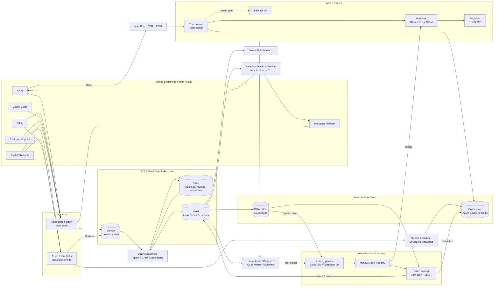
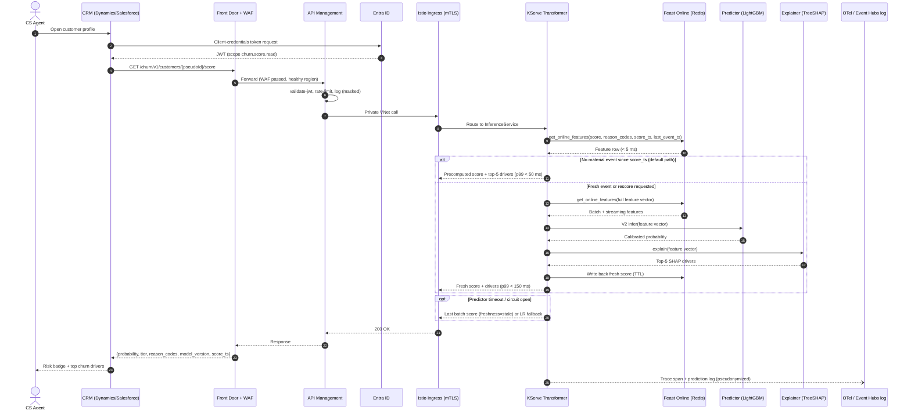
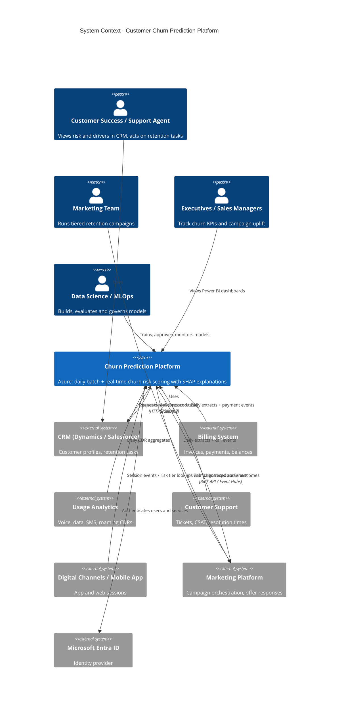
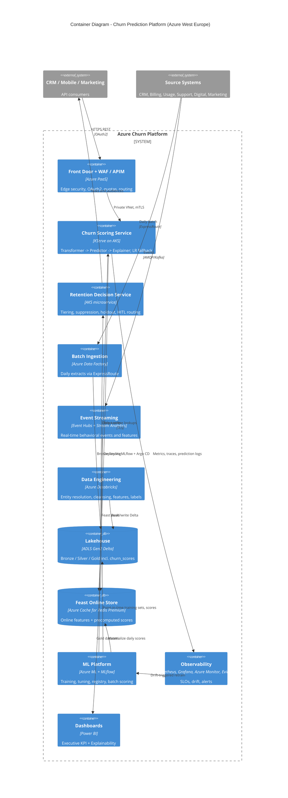

# Enterprise Customer Churn Prediction Platform: Enterprise AI System Design Document

**Author**: Enterprise AI Architecture Team
**Version**: 1.0
**Status**: Draft (for architecture review)
**Pattern**: Predictive ML (traditional ML pattern), hybrid batch and real-time inference
**Skill Compliance**: `ai-system-design-architect` (12-section enterprise standard)
**Inputs**:
- Problem statement: [`lab-ai-algorithm-selection/customer-churn-prediction/customer-churn-prediction.md`](customer-churn-prediction.md)
- Algorithm recommendation: [`lab-ai-algorithm-selection/customer-churn-prediction/algorithm-recommendation.md`](algorithm-recommendation.md)

**Companion artifacts (same folder)**:

| Artifact | Repo-relative path | Covered in |
|---|---|---|
| 10-page Draw.io architecture file | [`lab-ai-algorithm-selection/customer-churn-prediction/churn-architecture.drawio`](churn-architecture.drawio) | Section 8 |
| Terraform (Azure) | [`lab-ai-algorithm-selection/customer-churn-prediction/terraform/main.tf`](terraform/main.tf), [`variables.tf`](terraform/variables.tf), [`outputs.tf`](terraform/outputs.tf) | Section 10 |
| GitHub Actions MLOps pipeline | [`lab-ai-algorithm-selection/customer-churn-prediction/pipelines/churn-mlops-pipeline.yml`](pipelines/churn-mlops-pipeline.yml) | Section 11 |

---

## Executive Summary

A global telecom operator loses about 18% of its 18 million customers each year. This design delivers a predictive ML platform on Microsoft Azure that scores every active customer daily for the probability of churning within 90 days, and serves that score with its top-5 drivers to the CRM in real time.

| Decision | Choice |
|---|---|
| Model | LightGBM binary classifier (champion). CatBoost as challenger. WoE logistic regression as transparent fallback. Calibrated probabilities. TreeSHAP top-5 drivers per customer. |
| Inference | Daily Azure ML batch scoring of all 18M customers, plus a KServe real-time API on AKS. The API returns the precomputed score (p99 < 50 ms) or rescores with fresh streaming features (p99 < 150 ms). |
| Data | ADLS Gen2 Delta Lake medallion (Bronze/Silver/Gold), built with Azure Databricks. Feast feature store with the offline store on ADLS and the online store on Azure Cache for Redis. |
| Cloud | Azure only. West Europe primary across 3 availability zones. North Europe warm standby (active-passive). |
| SLA | 99.95% API availability, p99 < 500 ms end to end, 5,000 RPS peak. RPO ≤ 15 min for data, RTO ≤ 30 min for the scoring API. |
| Cost | About USD 480K per year all-in (prod, DR, non-prod, tooling), with USD 48K contingency. Total about USD 528K, under the USD 600K cap. |
| KPIs | Accuracy ≥ 85% is replaced as a gating metric. A single threshold with both Precision ≥ 85% and Recall ≥ 80% is reframed as **two operating tiers** (Section 1.4). |

No LLM is in the critical path.

---

## 1. AI Problem Classification

### 1.1 Classification

| Attribute | Value |
|---|---|
| **Domain category** | Predictive AI |
| **AI archetype** | Predictive ML: supervised binary classification on structured tabular data |
| **Target** | `churn_90d` = 1 if the customer terminates, or stays inactive for more than 90 consecutive days, within 90 days of the snapshot date |
| **Data modality** | About 240 structured features from 6 source systems. About 900M monthly activity records aggregated into point-in-time snapshot features. Call transcripts are deferred to Phase 2. |
| **Execution mode** | Hybrid: daily offline batch scoring of 18M customers, plus an online API for CRM, mobile and marketing (< 500 ms, 5,000 RPS) |
| **Output** | Calibrated churn probability, risk tier, top-5 SHAP drivers, model version, score timestamp |

### 1.2 Problem Statement Summary

Retention teams rely on manual SQL reports and fixed rules, for example "no login for 30 days". These find churners too late and produce many false positives. The platform must:
1. Rank every customer by 90-day churn risk early enough for intervention.
2. Explain each score to Customer Success staff. Explainability is mandatory.
3. Push risk into the CRM and the marketing platform, so that the right offer, at the right cost, reaches the right customer.
4. Measure the causal effect of retention actions through a randomized holdout.
5. Do this within GDPR, ISO 27001 and SOC 2 constraints, on CPU only (limited GPU), on the existing Azure estate, and within USD 600K per year.

### 1.3 Requirements Breakdown

| Category | Requirement | Design response |
|---|---|---|
| Functional | Daily batch scoring of 18M customers | Azure ML parallel batch pipeline. Scores ready by 06:00 CET. |
| Functional | Real-time score in the CRM customer profile | KServe InferenceService behind APIM. Precomputed and on-demand paths. |
| Functional | Per-customer explanation | TreeSHAP top-5 drivers, stored with every score and returned by the API |
| Functional | Weekly retraining, plus "daily model refresh" | Weekly scheduled retrain plus drift-triggered retrain. "Daily refresh" is met by daily rescoring with fresh features. Daily retraining adds cost without benefit (Section 1.4). |
| Functional | Explainability, model monitoring and executive KPI dashboards | Power BI (Executive KPI, Explainability) and Grafana (model and ops) |
| Non-functional | < 500 ms latency, 5,000 RPS, 99.95% availability | Redis-backed precomputed scores, HPA on a 3-AZ AKS node pool, DR region, circuit breaker |
| Non-functional | < 3% performance degradation between retrains | Delayed-label tracking of realized PR-AUC and Precision@K, alerted at > 3% relative drop |
| Constraint | GDPR, ISO 27001, SOC 2, RBAC, encryption, audit, masking | Section 7 views 3 and 6, Section 12 governance |
| Constraint | Limited GPU, USD 600K per year | CPU-only stack, spot and low-priority compute, reservations (Section 12.5) |
| Extensibility | Multi-country, new products | Country as a partition key in Delta and Feast, per-country calibration, CatBoost for new high-cardinality categoricals |

### 1.4 KPI Feasibility and Reframing (Accepted Design Decision)

The algorithm recommendation found that some technical KPIs are unrealistic as written. This design adopts its reframing as a formal acceptance contract. The business must sign it off in Phase 1.

| Original KPI | Problem | Reframed acceptance criterion |
|---|---|---|
| **Accuracy ≥ 85%** | Predicting "no churn" for everyone already gives about 82% accuracy at an 18% annual base rate. On 90-day labels (about 4–6% positives), it gives about 95%. The metric does not tell a useful model from a useless one. | **Removed as a gate.** It is reported for information only. It is replaced by **out-of-time PR-AUC** as the model-selection metric. The indicative target is ≥ 0.55, and the challenger must beat the champion. **Lift@top-decile ≥ 4×** is also required. |
| **Precision ≥ 85% and Recall ≥ 80%** at one threshold | At 4–6% prevalence, meeting both at once usually needs ROC-AUC well above 0.95. That is not credible for 90-day churn. | **Two calibrated operating points:** **Tier A (High-precision)**: precision ≥ 85% on the top-K customers, where K is set by the weekly capacity for costly offers (device subsidies, discounts). **Tier B (High-recall)**: recall ≥ 80% at a lower threshold, used only for low-cost nudges (app messages, loyalty points, service check-ins). |
| **ROC-AUC ≥ 0.90** | Achievable (expected range 0.88–0.92), but not guaranteed | Kept as a tracked **target**. The go-live gate is ROC-AUC ≥ 0.88 **and** a statistically significant gain over the WoE logistic baseline **and** Tier A and Tier B met. |
| **Latency < 500 ms** | Achievable | Kept. Internal SLOs: precomputed path p99 < 50 ms, rescoring path p99 < 150 ms |
| **< 3% degradation between retrains** | Labels mature only after 90 days | Measured on matured labels (realized PR-AUC and Tier A precision) against the release baseline. Leading indicators in between: PSI drift and score-distribution shift. |
| **Daily model refresh** | Contradicts "weekly retraining" | Interpreted as **daily scoring refresh**. The model is retrained weekly or when drift triggers it. |

The business KPIs (churn from 18% to below 14%, +25% campaign conversion, −15% CAC, +10% CLV) are measured **causally** against a randomized no-offer holdout (5% of each tier). Model metrics alone cannot show business impact.

---

## 2. Architecture Pattern Selection & Rationale

**Selected pattern**: **Predictive ML (Traditional ML pattern)**, extended for enterprise use:

`Data pipeline (medallion) -> Feature store (Feast) -> Training pipeline (Azure ML + MLflow) -> Model registry (MLflow) -> Hybrid serving (batch + KServe) -> Retention action orchestration -> Outcome feedback loop`

| Option | Assessment | Decision |
|---|---|---|
| Rule-based engine (current state) | Captures single obvious signals. Misses multi-factor patterns. Detects late and has a high false-positive rate. | Kept only as **hard overrides**: suppress scoring for customers in a dispute, legal hold or opt-out |
| Pure batch ML (no real-time API) | Cheapest option, but scores go stale between runs and cannot react to a support call that just happened | Rejected as the only path. Batch remains the **primary** path. |
| Pure real-time ML (score on every request) | 5,000 RPS × full feature assembly × SHAP. Highest cost and latency risk. | Rejected. On-demand rescoring is used **only** when fresh events exist. |
| Deep learning (TabNet, FT-Transformer, sequence models) | Needs GPUs. Little or no gain over GBDTs on tabular data. Harder to explain. | Rejected (limited GPU, explainability) |
| GenAI / RAG / LLM scoring | Wrong tool for a numeric risk prediction. Adds latency, cost and GDPR risk. | Rejected from the critical path. An optional Phase 3 LLM summary of SHAP drivers for agents could sit outside the SLA path. |
| **Hybrid batch + real-time GBDT with Feast** | Meets latency, cost, explainability and CPU-only constraints. Training-serving parity through Feast. | **Selected** |

**Model portfolio** (from the algorithm recommendation):
- **Champion**: LightGBM 4.x, `binary` objective, `scale_pos_weight` tuned on PR-AUC, isotonic calibration on an out-of-time fold.
- **Challenger**: CatBoost. It is benchmarked at every weekly retrain and promoted if it wins on out-of-time PR-AUC with no calibration or fairness regression.
- **Fallback**: L2 logistic regression with WoE encoding. It is a transparent scorecard, always deployed and used when the primary predictor is unavailable or quarantined.
- **Explainer**: TreeSHAP gives the top-5 drivers, mapped to business-readable reason codes (for example `BILL_SHOCK`, `USAGE_DECLINE_30D`, `REPEAT_COMPLAINT`).

---

## 3. Architecture Reasoning

| Concern | Choice | Rationale |
|---|---|---|
| **Cloud** | Microsoft Azure only (West Europe primary, North Europe DR) | Existing Azure estate. EU data residency for GDPR. Paired regions for DR. |
| **Ingestion** | Azure Data Factory (daily batch) plus Azure Event Hubs (streaming) | ADF has native connectors for on-prem CRM and billing over the self-hosted integration runtime and ExpressRoute. Event Hubs is Kafka-compatible for support-call, app-session and payment events. On-prem Kafka topics (call center, payments) are forwarded by Kafka MirrorMaker 2 running on-prem, over ExpressRoute to the Event Hubs Kafka endpoint (TLS, Entra ID/OAuth). |
| **Lakehouse** | ADLS Gen2 with Delta Lake, Bronze/Silver/Gold | ACID tables, time travel for reproducible training snapshots, partitioned by country and date |
| **Processing** | Azure Databricks (Spark, Photon, Structured Streaming) | Entity resolution, cleansing and feature engineering over 900M monthly records. Spot workers lower cost. Unity Catalog column masking. |
| **Data quality** | Great Expectations | Data contracts run both in CI and at pipeline runtime, with quarantine on failure |
| **Catalog and lineage** | Microsoft Purview | Scans ADLS, Databricks and Azure ML. Classifies PII. Gives end-to-end lineage for GDPR audit. |
| **Feature store** | Feast: offline on ADLS (Delta/Parquet), online on Azure Cache for Redis Premium (zone-redundant) | One feature definition repo. Point-in-time joins (`get_historical_features`) prevent leakage. Sub-10 ms online reads. |
| **Training** | Azure Machine Learning CPU clusters. Low-priority VMs for Optuna. | Mandated platform. CPU is enough for GBDTs. Low-priority VMs cut tuning cost by about 60–80%. |
| **Tracking and registry** | MLflow tracking and MLflow Model Registry, backed by the Azure ML workspace | Mandated. Stores signature, calibrator, SHAP explainer, data snapshot hash and model card per version. |
| **Batch scoring** | Azure ML batch pipeline (parallel run step) | Scales out on the same CPU clusters. Writes to Gold and materializes to Redis. |
| **Online serving** | KServe on a private AKS cluster: Transformer (Feast lookup) -> Predictor (MLServer LightGBM) -> Explainer (TreeSHAP) | Mandated. Native canary (`canaryTrafficPercent`), autoscaling, and a standard V2 inference protocol. |
| **Edge and API** | Azure Front Door Premium with WAF -> Application Gateway v2 (Private Link origin, private frontend) -> Azure API Management (Premium, internal VNet mode) -> AKS internal ingress (Istio add-on ingress gateway) | Global anycast entry and regional failover at Front Door. OAuth2 with Entra ID, quotas and versioning at APIM. mTLS inside the mesh. |
| **Observability** | Managed Prometheus and Azure Managed Grafana, Azure Monitor, Log Analytics, Application Insights, OpenTelemetry. Evidently AI for drift. | Mandated Prometheus/Grafana/Azure Monitor. Evidently gives PSI/KS drift reports as MLflow artifacts. |
| **Security** | Entra ID (SSO, RBAC, PIM), managed and workload identities, Key Vault (CMK), Private Endpoints, Azure Firewall, Defender for Cloud, Azure Policy | Zero-trust network. No secrets in code. Supports ISO 27001 and SOC 2 controls. |
| **CI/CD** | GitHub Actions (CI, CT, CD), Argo CD GitOps for AKS, Terraform for infrastructure | Mandated GitHub Actions. Argo CD gives drift-free, auditable cluster state. |
| **Compute class** | CPU only (D/F-series) | Meets the limited-GPU constraint. LightGBM inference takes < 5 ms per row. |

---

## 4. AI System Context & Boundary Table

| Context attribute | Specification |
|---|---|
| **Business problem** | 18% annual churn. Late, rule-based detection. Wasted retention offers. |
| **Use case** | 90-day churn risk scoring with explanations, driving tiered retention actions |
| **Target users** | Customer Success, Marketing, Sales Managers, Customer Support, Executive Leadership (primary). Data Science, Business Analysts (secondary). |
| **System consumers** | Dynamics 365 or Salesforce CRM (agent desktop), Mobile App backend, Marketing Platform (campaign orchestration), Power BI |
| **Input sources** | CRM, Billing, Usage Analytics (CDRs), Customer Support, Digital Channels, Marketing Platform |
| **Output interfaces** | REST API `GET /churn/v1/customers/{pseudoId}/score` and `POST /churn/v1/score:rescore`. Daily Gold score table. CRM and Marketing bulk push. Power BI datasets. |
| **Inference type** | Hybrid: daily batch (18M) plus real-time synchronous REST |
| **Scale** | 18M customers. 5 years of history. About 900M monthly activity records. About 240 features (pruned to about 80–150). Peak 5,000 RPS. |
| **Target cloud** | Microsoft Azure: West Europe (3 AZs) primary, North Europe warm standby |
| **SLA and latency** | 99.95% availability. End-to-end p99 < 500 ms. Precomputed path p99 < 50 ms. Rescoring path p99 < 150 ms. |
| **Data freshness** | Batch scores by 06:00 CET daily. Streaming features < 5 min end to end. |
| **Retraining** | Weekly scheduled, plus drift-triggered |
| **Compliance** | GDPR (DPIA, Art. 15/17/21/22 handling), ISO 27001, SOC 2 |
| **Budget** | USD 600K per year cap |
| **Out of scope (Phase 1)** | Call-transcript NLP features, uplift modeling, survival time-to-churn, LLM driver summaries |

---

## 5. Architecture Component Inventory (8 Enterprise Layers)

### 1. User Layer
| Component | Purpose |
|---|---|
| Customer Success and Support agents (CRM agent desktop) | See the risk score, tier and top-5 reason codes in the customer profile |
| Marketing team (Marketing Platform) | Build campaigns from tiered audiences |
| Sales Managers and Executives (Power BI) | Executive KPI dashboard: churn rate, saves, campaign uplift against holdout |
| Data Scientists (Azure ML Studio, Databricks notebooks, MLflow UI) | Experimentation, model review |
| Retention Review Analysts (HITL queue) | Review high-value or low-confidence cases |
| Mobile App backend | Fetches the risk tier for in-app retention journeys. It never receives raw SHAP values. |

### 2. Application Layer
| Component | Purpose |
|---|---|
| Azure Front Door Premium with WAF | Global entry, TLS termination, OWASP CRS and bot rules, health-probe failover between regions |
| CRM integration connector (Dynamics/Salesforce) | Score widget plus a nightly bulk upsert of scores and reason codes |
| Retention Decision Service (AKS microservice) | Maps score, tier and CLV to an offer eligibility and policy decision, applies suppression rules and holdout assignment |
| HITL Review App (Power Apps or internal web app) | Queue for Customer Success review |
| Power BI service | Executive and Explainability dashboards on Gold |

### 3. API Layer
| Component | Purpose |
|---|---|
| Azure API Management (Premium, internal VNet mode, 2 zone-redundant units) | OAuth2/JWT validation (Entra ID), per-consumer quotas and rate limits, API versioning, request/response logging (with masking) |
| AKS internal ingress (Istio add-on ingress gateway, internal load balancer) | L7 routing to KServe. mTLS from here inward. |
| Churn Scoring API (KServe V2 REST/gRPC) | `score` (precomputed) and `rescore` (fresh features) operations |
| Bulk Export API / Event publication | Publishes batch-score-ready events to Event Hubs for the CRM and Marketing Platform |

### 4. AI / ML Layer
| Component | Purpose |
|---|---|
| Feast feature registry (Git-backed, deployed via CI) | One set of feature definitions for training and serving |
| KServe Transformer | Resolves the pseudonymous ID, reads the Feast online store, chooses the precomputed or rescoring path |
| KServe Predictor (MLServer LightGBM runtime) | Calibrated churn probability |
| KServe Explainer (TreeSHAP) | Top-5 SHAP drivers mapped to reason codes |
| Fallback Predictor (WoE logistic regression InferenceService) | Transparent fallback model |
| Azure ML training pipeline | Point-in-time dataset build -> LightGBM and CatBoost training -> Optuna tuning -> calibration -> evaluation gates |
| Azure ML batch scoring pipeline | Daily scoring of 18M customers with SHAP |
| MLflow tracking and Model Registry | Experiments, lineage, stage gates, model cards |
| Evidently AI drift jobs | PSI/KS on top-20 SHAP features and on the score distribution |

### 5. Data Layer
| Component | Purpose |
|---|---|
| Azure Data Factory (with self-hosted integration runtime) | Daily batch extraction from CRM, Billing, Usage, Support, Digital, Marketing |
| Azure Event Hubs (Standard, auto-inflate, Capture to ADLS) | Real-time events: support calls, app sessions, payments, plan changes |
| Azure Stream Analytics and Databricks Structured Streaming | Windowed streaming features pushed to Feast (`push` source) |
| ADLS Gen2: Delta Bronze / Silver / Gold | Raw immutable data, cleansed and conformed data, features, labels and scores |
| Azure Databricks | Entity resolution, cleansing, feature engineering, label reconstruction |
| Feast offline store (Delta/Parquet on ADLS) | Point-in-time training datasets |
| Feast online store (Azure Cache for Redis Premium P3, 2 shards, zone-redundant) | Online features, precomputed scores and reason codes, about 18–25 GB |
| Great Expectations | Data contracts and quality gates |
| Microsoft Purview | Catalog, classification, lineage |

### 6. Security Layer
| Component | Purpose |
|---|---|
| Microsoft Entra ID (SSO, Conditional Access, MFA, PIM) | Identity for people and applications. Just-in-time privileged access. |
| Managed identities and AKS workload identity | Passwordless service-to-service access |
| Azure Key Vault Premium (HSM-backed CMK) | Keys for ADLS, Redis, AML, AKS etcd, Databricks. Secrets and certificates. |
| Private Endpoints and Private DNS zones | All PaaS reachable only privately |
| NSGs, Azure Firewall (hub), UDRs | Segmentation and egress control |
| WAF (Front Door), DDoS Network Protection (hub) | Perimeter protection |
| Istio mTLS (STRICT) and Kubernetes NetworkPolicies | East-west zero trust inside AKS |
| Presidio and Databricks Unity Catalog column masking | PII detection and masking. Pseudonymized customer IDs. |
| Defender for Cloud (CSPM, Containers, Storage, Key Vault), Azure Policy | Posture management, threat detection, guardrails (deny public IPs, require CMK, allowed regions) |
| Immutable audit storage (WORM blob) and Log Analytics | Tamper-evident audit trail |

### 7. Infrastructure Layer
| Component | Purpose |
|---|---|
| Hub-spoke VNets (hub: Firewall, Bastion, VPN/ExpressRoute gateway; spoke 10.20.0.0/16) | Network foundation |
| Private AKS cluster (system pool plus CPU user pool across 3 AZs, Azure CNI Overlay, Istio add-on) | KServe serving, Retention Decision Service, Argo CD |
| Azure ML workspace with managed VNet and CPU compute clusters (dedicated plus low-priority) | Training, tuning, batch scoring |
| Azure Databricks (VNet-injected, secure cluster connectivity) | Data engineering |
| Azure Container Registry Premium (geo-replicated to North Europe) | Images and model containers |
| North Europe DR spoke | Warm standby AKS, Redis geo-replica, APIM regional unit |

### 8. Operations & Observability Layer
| Component | Purpose |
|---|---|
| Azure Monitor managed Prometheus and Azure Managed Grafana | Latency, RPS, errors, saturation, KServe and Redis metrics |
| Log Analytics and Application Insights | Centralized logs, request telemetry, KQL alerting |
| OpenTelemetry (SDK plus collector) | Distributed traces Front Door -> APIM -> Transformer -> Redis -> Predictor -> Explainer |
| Evidently AI (scheduled Azure ML jobs) | Feature, score and prediction drift reports |
| Delayed-label performance job | Realized PR-AUC, Tier A precision and Tier B recall as 90-day outcomes mature |
| Alertmanager and Azure Monitor alerts -> PagerDuty and Microsoft Teams | Paging and notification |
| Azure Cost Management budgets and anomaly alerts | FinOps |
| Argo CD | GitOps reconciliation and drift detection |

---

## 6. Interaction Flow & Request Lifecycle

### 6.1 Flow A: Daily Batch Pipeline (Data -> Features -> Scores -> Action)

| # | Time (CET) | Step |
|---|---|---|
| 1 | 00:30 | **ADF** extracts the daily deltas from CRM, Billing, Usage (CDR aggregates), Support, Digital and Marketing over ExpressRoute and the self-hosted integration runtime into **Bronze** (immutable, partitioned by `country/ingest_date`). |
| 2 | 01:15 | **Great Expectations** contracts validate schema, volume, null rates and freshness. Failed partitions are quarantined, the pipeline alerts, and the previous day's features are reused with a `stale_features` flag. |
| 3 | 01:30 | **Databricks Silver jobs** run entity resolution (deterministic plus fuzzy matching on pseudonymized keys), standardize addresses, deduplicate, and apply PII masking with Unity Catalog column masks. Direct identifiers are replaced by `pseudo_customer_id` (keyed HMAC, key in Key Vault). |
| 4 | 02:15 | **Databricks Gold jobs** compute about 240 features (rolling windows, trends, billing friction, service quality, engagement) as Feast feature views with event timestamps. They also rebuild 90-day labels for snapshots older than 90 days. |
| 5 | 03:00 | **Feast materialization** runs (offline -> online for daily feature views). |
| 6 | 03:30 | **Azure ML batch scoring pipeline** loads the Production champion from the MLflow registry. A parallel run step scores 18M customers in under 60 minutes on a CPU cluster, computes TreeSHAP top-5, and assigns the calibrated tier (A, B or Low). |
| 7 | 04:30 | Scores are written to **Gold `churn_scores`** (Delta, versioned) and **pushed to the Feast online store** (`churn_score`, `tier`, `reason_codes`, `model_version`, `score_ts`). |
| 8 | 05:00 | The **Retention Decision Service** applies suppression rules (opt-out, dispute, legal hold, recent offer), assigns the randomized holdout (5% per tier), computes expected value (P(churn) × CLV − offer cost), and routes high-value or low-confidence cases to the **HITL queue**. |
| 9 | 05:30 | Bulk upsert to the **CRM** (score widget fields) and the **Marketing Platform** (tiered audiences). A `scores.ready` event goes to Event Hubs. |
| 10 | 06:00 | **Power BI** datasets refresh. The Evidently drift job runs on the new score distribution. |

### 6.2 Flow B: Real-Time CRM Request

1. An agent opens a customer profile. The CRM backend calls `GET /churn/v1/customers/{pseudoId}/score` with an Entra ID OAuth2 client-credentials token.
2. **Front Door WAF** inspects the request and routes it to the healthy region. **APIM** validates the JWT (audience, scope `churn.score.read`), applies the per-consumer rate limit, and forwards over the private network.
3. The **Istio ingress gateway** forwards to the **KServe Transformer** over mTLS.
4. The Transformer reads the Feast online store (Redis). It gets the precomputed score, reason codes and `score_ts`, plus the streaming feature `last_event_ts`.
5. **Decision**:
   - **Precomputed path (default, about 80% of traffic)**: no material event since `score_ts`, so the stored score is returned. p99 < 50 ms.
   - **Rescoring path**: a material event exists since `score_ts` (support call ended, failed payment, plan downgrade), or the caller requested `rescore`. The Transformer assembles a fresh feature vector from Feast (batch features plus streaming features) and calls the **Predictor**, then the **Explainer**. The new score is written back to Redis with a TTL. p99 < 150 ms.
6. The response contains `{probability, tier, reason_codes[5], model_version, score_ts, freshness}`. It is logged through OpenTelemetry. The prediction log goes to Event Hubs and then ADLS for monitoring and audit, with no raw PII.
7. **Failure handling**: if the Predictor or Explainer is slow (> 200 ms) or failing, the circuit breaker returns the last batch score with `freshness=stale`. If no batch score exists (new customer), the request goes to the **logistic regression fallback** InferenceService.

### 6.3 Flow C: Streaming Feature Update

1. Support, app and payment systems publish events to **Event Hubs** (partitioned by `pseudo_customer_id`).
2. **Stream Analytics or Databricks Structured Streaming** compute windowed features (`tickets_24h`, `failed_payments_7d`, `app_sessions_7d_delta`).
3. Features are pushed to Feast (`push` source -> online store). Event Hubs **Capture** lands the raw events in Bronze for offline parity.
4. End-to-end streaming feature latency is < 5 min (SLO).

### 6.4 Flow D: Retraining (Weekly Scheduled and Drift-Triggered)

1. **Triggers**: a weekly schedule (Sunday 02:00), or an Evidently alert (PSI > 0.2 on any top-20 SHAP feature or on the score distribution), or a delayed-label alert (> 3% relative drop in realized PR-AUC). The trigger fires a GitHub Actions `workflow_dispatch` (CT job).
2. The Azure ML pipeline builds a point-in-time training set from the Feast offline store (rolling 24–36 months of monthly snapshots) with a 90-day label gap and group-aware splits.
3. LightGBM (champion candidate) and CatBoost (challenger) are trained. Optuna tuning runs on low-priority nodes against out-of-time PR-AUC. The WoE logistic regression baseline is refreshed.
4. Isotonic calibration. TreeSHAP explainer packaging. Leakage tests (single-feature AUC > 0.95 is flagged).
5. **Evaluation gates** (all must pass): beats the current champion on out-of-time PR-AUC; ROC-AUC ≥ 0.88; Tier A precision and Tier B recall met; ECE ≤ 0.02; fairness parity (FPR and TPR gaps ≤ 5 percentage points across age band and region); p99 latency in the load test.
6. The candidate is registered in **MLflow** with its model card. The stage moves None -> Staging.
7. CD: **shadow** deployment for 7 days, then **canary** at 10%, 50% and 100% through KServe `canaryTrafficPercent`, with automatic rollback on SLO or score-distribution anomaly. A **manual approval** (Model Risk Owner) is required for the GitHub `production` environment.

### 6.5 Flow E: Retention Action and Outcome Feedback Loop

Score -> tier -> Retention Decision Service (policy, CLV, holdout) -> CRM task or Marketing campaign -> customer response (accept, decline, churn) -> outcomes in Marketing and CRM -> ADF -> Silver `retention_outcomes`. Outcomes feed: (a) causal uplift measurement against the holdout for the business KPIs; (b) future uplift modeling (Phase 3); (c) label maturity for delayed-label monitoring.

### 6.6 Flow F: GDPR Data-Subject Requests

- **Right to erasure (Art. 17)**: a DSR ticket triggers a Databricks job that deletes the subject from Silver/Gold (Delta `DELETE` + `VACUUM` after the retention window), deletes the Feast online keys, and adds a tombstone to exclude the subject from future training snapshots. Bronze is purged by a lifecycle policy within 30 days. Purview lineage records the action.
- **Right of access and explanation (Art. 15, 22)**: the latest score and reason codes are exported from Gold in plain language.
- **Right to object to profiling (Art. 21)**: a suppression flag in CRM excludes the customer from scoring-driven marketing.

---

## 7. Architecture Diagrams (10 Views)

### 7.0 Mermaid Diagrams

#### 7.0.1 Logical Flow (End to End)

#### 7.0.2 Sequence Diagram: Real-Time CRM Request

#### 7.0.3 C4 Level 1: System Context

#### 7.0.4 C4 Level 2: Container Diagram

### 7.1 View 1: Logical Architecture View

The 8 layers are arranged as color-coded columns. Actors (CS agent, Marketing, Executives, Data Scientists) sit on the left edge. Source systems sit on the right edge.
- **Inference paths**: batch (Gold -> Feast -> CRM and Marketing) and real-time (CRM -> Front Door -> APIM -> KServe -> Redis).
- **Processing path**: Sources -> ADF and Event Hubs -> Bronze/Silver/Gold -> Feast -> Azure ML.
- **Response path**: score, tier and reason codes return to the CRM. Outcomes return to Silver.
- **Cross-cutting bars**: Security (Entra ID, Key Vault, Private Endpoints) and MLOps/Observability (GitHub Actions, MLflow, Prometheus/Grafana, Evidently).

### 7.2 View 2: Infrastructure Architecture View (Azure Landing Zone & Hybrid Connectivity)

The skill's multi-cloud page is replaced, because the platform is Azure only. This view shows **hybrid connectivity**.
- **On-premises data center**: CRM and Billing databases, CDR mediation platform, self-hosted integration runtime VMs, and a Kafka MirrorMaker 2 event forwarder that sends support-call and payment events to the Event Hubs Kafka endpoint (port 9093, TLS) over ExpressRoute and the Event Hubs private endpoint.
- **Connectivity**: ExpressRoute private peering (primary) and site-to-site VPN (backup). Both terminate in the hub `GatewaySubnet`.
- **Hub VNet** `10.10.0.0/16` (West Europe): Azure Firewall (forced-tunnel egress, FQDN rules), Azure Bastion, ExpressRoute/VPN gateways, DDoS Network Protection, Private DNS resolver.
- **Spoke VNet** `10.20.0.0/16`: peered to the hub. UDR 0.0.0.0/0 -> Firewall.
- **DR spoke** (North Europe, `10.30.0.0/16`): peered to the North Europe hub (platform-owned, optional `dr_hub_vnet_id`). Global VNet peering to the West Europe spoke for replication traffic.
- **Management group and subscription hierarchy**: Platform (connectivity, identity, management) and Landing Zones (corp: churn-prod, churn-nonprod). Azure Policy is assigned at management-group scope.
- SaaS CRM (Salesforce, if used) connects through Front Door (inbound API) and a private connector (outbound bulk API).

**Region detail** (Draw.io page 3): Azure > West Europe > spoke VNet > AZ1/AZ2/AZ3 > subnets. AKS system and user node pools spread across the 3 AZs. APIM units in AZ1 and AZ2. Redis zone-redundant primary and replica. Private Endpoints for ADLS, Key Vault, ACR, AML, Redis, Event Hubs and Databricks. See Section 9 for the subnet plan.

### 7.3 View 3: Security Architecture View

The 4-quadrant layout:
- **Top-left: Identity and Access**. Entra ID SSO with Conditional Access and MFA. App registrations for each consumer (CRM, Mobile, Marketing) with scoped app roles (`churn.score.read`, `churn.score.rescore`). PIM for Owner/Contributor (just-in-time, approval, 4-hour max). Managed identities for ADF, AML and Databricks. AKS workload identity for KServe pods (read-only Redis, ACR pull). RBAC groups: `grp-churn-ds`, `grp-churn-mlops`, `grp-churn-cs-viewers`, `grp-churn-dpo`.
- **Top-right: Policy and Compliance**. Azure Policy initiatives: deny public network access, require CMK, allowed locations (EU only), require tags, AKS pod security baseline. Mapping to GDPR, ISO 27001 Annex A and SOC 2. DPIA register.
- **Bottom-left: Audit and Monitoring**. Diagnostic settings from every resource go to Log Analytics. Immutable (WORM, 7-year) audit storage. APIM request logs with PII masking. MLflow registry transition history. Purview access reports.
- **Bottom-right: Threat Protection**. Front Door WAF (OWASP CRS 3.2, bot manager, geo-filtering, rate limit). DDoS protection. Defender for Containers, Storage and Key Vault. Trivy image scanning in CI. ACR content trust. Microsoft Sentinel integration (optional, enterprise SOC).
- **Governance bar**: Secure Score dashboard, policy compliance percentage, open findings.
- **Data security**: TLS 1.2+ everywhere (TLS 1.3 at Front Door). Istio mTLS STRICT. AES-256 encryption at rest with CMK in Key Vault (HSM). Customer IDs pseudonymized with keyed HMAC. Consumers never see raw PII. Reason codes are business-level, not raw feature values.
- **ML-specific controls**: model artifacts are signed and hash-verified at load time. Registry write access is limited to the CD service principal. Inference inputs are schema-validated in the Transformer, which rejects unknown fields. Per-consumer rate limits mitigate model-extraction attempts.

### 7.4 View 4: Observability, Logging & Monitoring View

4 rows:

| Row | Components |
|---|---|
| **Collection** | Managed Prometheus (kube-state, KServe, Istio, Redis exporter), OpenTelemetry collector (traces), Container Insights, Application Insights SDK, Evidently drift jobs, delayed-label performance job, ADF/Databricks run telemetry |
| **Visualization** | Grafana: API SLO dashboard (RPS, p50/p95/p99, error rate, saturation), model health (score distribution, tier mix, rescore ratio, fallback rate), feature freshness. Power BI: Explainability (global SHAP, reason-code mix by segment) and Executive KPI (churn rate, saves, uplift against holdout). Log Analytics workbooks. |
| **Alerting** | Alertmanager and Azure Monitor alert rules -> PagerDuty (Sev1/Sev2) and Teams (Sev3). Key alerts: p99 > 300 ms for 5 min; 5xx > 0.5%; fallback rate > 2%; batch not complete by 05:30; feature freshness > 6 h; PSI > 0.2; realized PR-AUC drop > 3%; Redis memory > 80%; budget > 80%. |
| **Operations** | HPA and cluster autoscaler, KServe auto-rollback, Argo CD self-heal, runbooks (Azure Automation), drift-triggered retrain, DR failover drill, post-incident review |

**Key SLIs and SLOs**:

| SLI | SLO |
|---|---|
| API availability (successful responses / total, measured at APIM) | 99.95% per 30 days (21.9 min error budget) |
| Precomputed path latency | p99 < 50 ms (service-side) |
| Rescoring path latency | p99 < 150 ms (service-side) |
| End-to-end latency (CRM-observed) | p99 < 500 ms |
| Batch completion | Scores in Redis and CRM by 06:00 CET on 99% of days |
| Streaming feature freshness | < 5 min p95 |
| Score drift | PSI < 0.2 against the reference week |
| Realized performance | ≤ 3% relative drop in PR-AUC and Tier A precision against the release baseline |

### 7.5 View 5: MLOps / CI/CD / CT Pipeline View

Left to right:
1. **Source**: GitHub monorepo (`features/` Feast repo, `src/` training and scoring, `serving/` KServe manifests, `infra/` Terraform). Trunk-based development with PR reviews.
2. **CI**: lint (ruff, black), unit tests, Great Expectations contract tests, leakage tests, Feast `plan`, container build, Trivy scan, SBOM.
3. **CT**: Azure ML pipeline (dataset build -> train LightGBM, CatBoost, LR -> Optuna -> calibrate -> evaluate).
4. **Registry**: MLflow registration with model card. Stage gates.
5. **CD**: GitOps PR to the serving manifests -> Argo CD -> shadow -> canary 10/50/100 -> manual production approval -> auto-rollback.
6. **Monitor**: Evidently and delayed-label metrics.

A **dashed feedback loop** runs from Monitor back to CT (drift or degradation triggers a retrain). A data pipeline sub-lane (ADF -> Databricks -> Feast materialization) sits underneath.

### 7.6 View 6: Data Lineage & Privacy Governance View

Lineage runs top to bottom:

`Source systems -> Bronze (raw, restricted, 30-day PII retention) -> Presidio and Purview classification -> pseudonymization (HMAC) and column masking -> Silver (masked) -> feature engineering -> Gold features and labels -> Feast offline -> training dataset (snapshot hash) -> model version (MLflow) -> score and reason codes -> CRM and Marketing`

- **Isolation boundaries**: Bronze is readable only by the data-engineering managed identity. Silver and Gold use Unity Catalog row filters by `country` for multi-country isolation, and column masks for quasi-identifiers (birth date, postcode).
- **Data minimization**: sensitive attributes (exact age, gender, nationality) are excluded from model features. Age band and region are kept **only for fairness auditing**.
- **Audit sidebar**: Purview lineage, Delta table history, MLflow run to dataset hash, APIM access logs, DSR (erasure) log.
- **Retention**: Bronze PII 30 days; Silver/Gold 5 years (pseudonymized); prediction logs 13 months; audit 7 years (WORM).
- **Lawful basis**: legitimate interest for retention analytics (documented LIA plus DPIA). Marketing use respects consent and objection flags.

### 7.7 View 7: Resilience, HA & Model Fallback View (adapted from LLM Fallback)

- **Zonal HA (West Europe)**: AKS node pools across AZ1–3 (minimum 2 replicas per KServe component, topology spread constraints, PodDisruptionBudgets). APIM Premium with 2 zone-redundant units. Redis Premium zone-redundant with replica. ZRS storage for hot data.
- **Regional DR (North Europe, warm standby, active-passive)**: AKS cluster at minimum scale with the same Argo CD apps synced. Redis passive geo-replica. ADLS GRS/RA-GRS for the lake. ACR geo-replication. APIM regional gateway unit. MLflow model artifacts replicated through the Azure ML registry. Front Door priority routing fails over automatically on health-probe failure.
- **Model fallback chain** (degradation ladder):
  1. **Champion LightGBM** with fresh features (rescoring path).
  2. **Precomputed batch score** from Redis (circuit breaker opens on Predictor p99 > 200 ms or > 5% errors in 30 s). Response flag `freshness=stale`.
  3. **WoE logistic regression fallback** InferenceService, for customers with no batch score or when the champion is quarantined. Flag `model=fallback_lr`.
  4. **Rules-only safe default**: tier `UNKNOWN` with reason `SERVICE_DEGRADED`. The CRM shows "score unavailable" and never blocks the agent.
- **Resilience patterns**: Istio retries (1 retry, 50 ms budget) and outlier detection. Timeouts at each hop (APIM 400 ms, Transformer 300 ms). Bulkheads (separate deployments for the precomputed and rescoring paths). Batch pipeline retries with idempotent Delta `MERGE`. Stale-feature flagging when upstream pipelines are late.

### 7.8 View 8: Retention Action Orchestration & CRM Integration (adapted from Multi-Agent Orchestration)

No autonomous agents are used. The orchestration is deterministic and auditable:

`Score (P) -> calibrated tier (A / B / Low) -> eligibility and suppression rules -> holdout assignment (5%) -> expected-value ranking (P × CLV − offer cost) -> offer and channel decision -> CRM task (Tier A: CS call with offer) or Marketing journey (Tier B: nudge) -> customer response -> outcome capture -> Silver retention_outcomes -> uplift measurement and labels`

- **Retention Decision Service** (AKS microservice): a versioned policy table (offer catalog, cost, eligibility) in Git, so policy changes are reviewed like code.
- **HITL branch**: high-value accounts (CLV in the top 5%) and low-confidence predictions (probability within ±0.05 of a tier threshold) go to the Customer Success review queue before costly offers.
- **Integration patterns**: real-time score widget (pull via API), nightly bulk upsert (CRM bulk API), event-driven audience update (Event Hubs `scores.ready` -> Marketing Platform connector).
- **State**: decisions and outcomes are persisted in Gold (`retention_decisions`, `retention_outcomes`) for audit and causal analysis.

### 7.9 View 9: FinOps & Compute Cost Optimization (adapted from Semantic Cache)

- **Precomputed score cache**: about 80% of real-time requests are answered from Redis without model compute. This is the predictive-ML equivalent of a semantic cache. Rescoring runs only when a material event exists.
- **Compute tiering**: Optuna tuning on **low-priority** Azure ML VMs. Databricks job clusters with **spot** workers and Photon. Batch scoring on autoscaling clusters that scale to zero when idle.
- **Autoscaling**: KServe HPA (concurrency target) and the AKS cluster autoscaler (user pool 4–16 nodes). Baseline nodes covered by **1-year reserved instances or a savings plan**.
- **Right-sizing**: features pruned from about 240 to 80–150 (smaller Redis footprint, faster scoring). Redis TTL on rescored entries.
- **Budgets**: Azure Cost Management budgets per resource group (alerts at 50%, 80% and 100%), anomaly alerts, a mandatory `cost-center` tag enforced by policy, and a monthly FinOps review.
- **Edge annotations on the diagram**: "cache hit: ~USD 0", "rescore: CPU ms", "tuning: low-priority −70%".

### 7.10 View 10: Model Governance, Fairness & HITL (adapted from AI Safety & HITL)

Pipeline with decision diamonds:

`Candidate model -> [PR-AUC > champion?] -> [Tier A precision ≥ 85% and Tier B recall ≥ 80%?] -> [ECE ≤ 0.02?] -> [Fairness: FPR/TPR gap ≤ 5 pp?] -> [Leakage and stability check passed?] -> model card generated -> HITL Model Risk review (DS lead + Model Risk Owner + DPO for material changes) -> MLflow stage: None -> Staging -> (shadow and canary) -> Production -> Archived`

- Any failed diamond -> **Reject** -> logged to MLflow with the reason -> the champion is kept.
- **Operational HITL**: Customer Success review queue for high-value or low-confidence cases (View 8). Agents can mark reason codes as "unhelpful" or "incorrect". This feedback goes into a monthly explanation-quality review.
- **Model card contents**: intended use, out-of-scope use, training data window, metrics by tier and by segment, fairness results, known limitations, explanation method, approvers.

---

## 8. Draw.io Multi-Page XML File

The full architecture is in a separate importable file. The XML is not inlined here.

**File**: [`lab-ai-algorithm-selection/customer-churn-prediction/churn-architecture.drawio`](churn-architecture.drawio). Open it at app.diagrams.net or in the draw.io desktop or VS Code extension.

| Page | Title | Layout pattern | Key contents |
|---|---|---|---|
| 1 | Logical Architecture (8 layers) | Layered color-coded columns, actors on the edges | User, Application, API, AI/ML, Data, Security, Infrastructure and Operations layers with emoji service cards; batch and real-time paths |
| 2 | Azure Landing Zone & Hybrid Connectivity | On-prem <-> Azure hub-spoke (replaces the multi-cloud page) | On-prem CRM and Billing, self-hosted integration runtime, ExpressRoute and VPN, hub (Firewall, Bastion, gateways), spoke and DR spoke, management groups |
| 3 | Infrastructure Region Detail | Nested Azure > West Europe > VNet > AZ1–3 > subnets with native Azure icons | AKS system and user pools, APIM, Private Endpoints, Databricks subnets, AML subnet, Redis, ADLS |
| 4 | Data Architecture | Left-to-right pipeline | 6 sources -> ADF and Event Hubs -> Bronze/Silver/Gold cylinders -> Databricks and Great Expectations -> Feast offline and online -> consumption (AML, KServe, Power BI, CRM) |
| 5 | MLOps CI/CD/CT Pipeline | Left-to-right with a dashed retrain loop | GitHub -> CI -> CT (Azure ML) -> MLflow registry -> Argo CD and KServe canary -> Evidently monitoring -> retrain trigger |
| 6 | Model Serving | Left-to-right detail | CRM, Mobile and Marketing -> Front Door and WAF -> APIM -> Istio ingress -> KServe Transformer, Predictor and Explainer (+ LR fallback) -> Redis and ADLS |
| 7 | Security & Governance | 4 quadrants plus governance bar plus legend | Identity, Policy and Compliance, Audit, Threat protection |
| 8 | Monitoring & Operations | 4 rows | Collection -> Visualization -> Alerting -> Operations |
| 9 | Data Governance & Privacy | Top-to-bottom lineage | PII detection, pseudonymization, masking, country isolation, retention, DSR and erasure, Purview lineage, audit sidebar |
| 10 | Model Governance, Fairness & HITL | Pipeline with decision diamonds | Evaluation gates, fairness audit, model card, HITL review queue, MLflow stage gates |

The 10-page list fixed in the design brief does not give views 7 (Resilience and model fallback), 8 (Retention orchestration) or 9 (FinOps) their own pages. Section 7 is the reference for those views. Their main elements also appear on related pages: the fallback predictor and DR routing on page 6, the CRM and Marketing integration on pages 1 and 6, and the low-priority and spot compute on page 5. View 10 has its own page (page 10). The Azure landing zone page replaces the multi-cloud page.

---

## 9. Infrastructure Architecture Specifications

> The CIDRs and SKUs below are the **reference design**. If they differ, the authoritative values are in [`terraform/variables.tf`](terraform/variables.tf).

### 9.1 Network Topology

| Item | Specification |
|---|---|
| Topology | Hub-spoke. Hub owned by the platform team. Workload spoke owned by the churn team. |
| Primary region | West Europe (AZ 1, 2, 3) |
| DR region | North Europe (warm standby), spoke `10.30.0.0/16` |
| Hub VNet | `AzureFirewallSubnet`, `AzureBastionSubnet`, `GatewaySubnet` (ExpressRoute plus VPN) |
| Spoke VNet | `10.20.0.0/16`, peered to the hub. UDR default route to Azure Firewall. |
| DNS | Azure Private DNS zones for each Private Link service, linked to hub and spoke |
| Hybrid | ExpressRoute (1 Gbps) primary, site-to-site VPN backup, to on-prem CRM and Billing (ADF self-hosted IR) and the on-prem Kafka MirrorMaker 2 forwarder (Event Hubs Kafka endpoint, 9093/TLS) |

### 9.2 Spoke Subnet Plan (West Europe)

| Subnet | CIDR (indicative) | Hosts | NSG highlights |
|---|---|---|---|
| `snet-aks-system` | 10.20.0.0/22 | AKS system node pool (CriticalAddonsOnly) | Allow from `snet-apim` to the internal LB only |
| `snet-aks-user` | 10.20.4.0/22 | AKS user pool (KServe, Retention Decision Service) | East-west within the VNet. Egress via Firewall. |
| `snet-apim` | 10.20.12.0/26 | APIM Premium (internal VNet mode) | Inbound 443 from the VNet (Application Gateway), 3443 ApiManagement |
| `snet-appgw` | 10.20.14.0/24 | Application Gateway Standard_v2 (private frontend in front of internal APIM) | 65200-65535 GatewayManager, AzureLoadBalancer, 443 from the VNet, deny Internet |
| `snet-appgw-pl` | 10.20.15.0/27 | App Gateway Private Link NAT IPs (Front Door Premium private origin) | Private Link service network policies disabled |
| `snet-private-endpoints` | 10.20.13.0/24 | PEs: ADLS (dfs, blob), Key Vault, ACR, Redis, Event Hubs, AML, Databricks UI | Deny all inbound except from spoke subnets |
| `snet-aml` | 10.20.24.0/23 | Azure ML compute clusters (if not using the managed VNet) | Egress to PEs and AML service tags |
| `snet-databricks-public` | 10.20.16.0/22 | Databricks host subnet (delegated) | Databricks-managed NSG rules |
| `snet-databricks-private` | 10.20.20.0/22 | Databricks container subnet (delegated) | Databricks-managed NSG rules |

### 9.3 Compute

| Cluster or service | Pool / SKU | Scale | Purpose |
|---|---|---|---|
| AKS `aks-churn-prod-weu` (private, Standard tier with uptime SLA, Azure CNI Overlay, Istio add-on, workload identity) | System: `Standard_D4s_v5` | 3 (1 per AZ) | CoreDNS, Istio control plane, Argo CD |
| | User: `Standard_D8s_v5` | 4–16, zones 1–3, cluster autoscaler | KServe Transformer, Predictor, Explainer, fallback LR, Retention Decision Service |
| KServe sizing at 5,000 RPS (indicative) | Transformer ~800 RPS/pod (2 vCPU); Predictor and Explainer ~300 RPS/pod on the rescoring path | Transformer 8–10 pods; Predictor 4–6 pods at peak (about 20% rescore ratio) | Load-tested in CD before promotion |
| Azure ML compute | `cpu-training`: `Standard_F32s_v2`, 0–8 dedicated nodes. `cpu-tuning-spot`: `Standard_F16s_v2`, 0–20 low-priority. `cpu-batch`: `Standard_D16s_v5`, 0–10. | Scale to zero | Weekly training, Optuna tuning, daily batch scoring |
| Azure Databricks (Premium) | Job clusters, Photon, `Standard_E8ds_v5` driver plus spot workers (2–16) | Ephemeral | Daily ETL and features. Structured Streaming on a small always-on cluster. |
| DR AKS `aks-churn-prod-dr` (North Europe) | Same pools at minimum (system 3, user 2) | Scales out on failover | Warm standby |

### 9.4 Storage & Data Services

| Service | Configuration |
|---|---|
| ADLS Gen2 | HNS enabled, CMK, private endpoints only, containers `bronze`, `silver`, `gold`, `feast-offline`, `audit` (immutable WORM). ZRS for hot zones. GRS for Gold and audit. Lifecycle: Bronze -> Cool at 30 days, PII purge at 30 days; older history -> Cold at 180 days. About 60 TB in total. |
| Azure Cache for Redis | Premium P3 (26 GB/shard), 2 shards, zone-redundant, 1 replica, TLS only, private endpoint, passive geo-replication to North Europe. AOF persistence only when DR is off (`redis_aof_persistence_enabled` and `enable_dr = false`): Azure does not support persistence on geo-replicated caches, so with DR on, durability comes from the geo-replica plus rebuild from Gold `churn_scores` |
| Event Hubs | Standard namespace, 8 TUs with auto-inflate to 20, Capture to Bronze. Hubs: `support-events`, `app-sessions`, `payment-events`, `prediction-logs`, `scores-ready`. |
| Azure ML workspace | Managed VNet (allow-only-approved outbound), CMK, MLflow tracking, Azure ML registry replicated to North Europe |
| ACR | Premium, geo-replicated to North Europe, private endpoint, content trust, Defender scanning |
| Key Vault | Premium (HSM), RBAC mode, purge protection, soft delete 90 days |
| Log Analytics | Workspace in West Europe, commitment tier, 90-day interactive retention plus archive. Basic logs for high-volume container stdout. |

---

## 10. Infrastructure as Code (Terraform)

The Terraform code is in separate files. It is not inlined here.

| File | Repo-relative path | Contents (summary) |
|---|---|---|
| `main.tf` | [`lab-ai-algorithm-selection/customer-churn-prediction/terraform/main.tf`](terraform/main.tf) | Providers and backend, resource groups, networking, data, ML, serving, security and monitoring resources (see below) |
| `variables.tf` | [`lab-ai-algorithm-selection/customer-churn-prediction/terraform/variables.tf`](terraform/variables.tf) | Region pair, environment, CIDRs, SKUs, node counts and sizes, tags, budget amount |
| `dr.tf`, `governance.tf`, `streaming.tf` | [`terraform/dr.tf`](terraform/dr.tf), [`terraform/governance.tf`](terraform/governance.tf), [`terraform/streaming.tf`](terraform/streaming.tf) | North Europe warm standby (DR spoke, AKS, Redis geo-replica; gated by `enable_dr`), Microsoft Purview (private endpoints), Stream Analytics job (Event Hubs -> ADLS) |
| `outputs.tf` | [`lab-ai-algorithm-selection/customer-churn-prediction/terraform/outputs.tf`](terraform/outputs.tf) | AKS name and OIDC issuer, APIM gateway URL, Redis host, ADLS endpoints, AML workspace ID, Key Vault URI, Event Hubs namespace |

**Resource coverage expected in `main.tf`, grouped by concern**:

| Concern | Azure resources (`azurerm_*`) |
|---|---|
| Foundation | `resource_group`, tags, `virtual_network` (spoke) plus `subnet` plan from Section 9.2, `network_security_group` and associations, `route_table` (UDR to the hub firewall), VNet peering to the hub, `private_dns_zone` plus links |
| Data | `storage_account` (ADLS Gen2, HNS, CMK) plus `storage_data_lake_gen2_filesystem` (bronze, silver, gold, feast-offline, audit), `eventhub_namespace` plus `eventhub`, `data_factory`, `databricks_workspace` (VNet-injected, no public IP) |
| ML | `machine_learning_workspace`, `machine_learning_compute_cluster` (train, tune with low priority, batch), `application_insights`, `container_registry` (Premium, geo-replication) |
| Serving | `kubernetes_cluster` (private, zones 1–3, Istio add-on, workload identity, OIDC), `kubernetes_cluster_node_pool` (user CPU pool), `redis_cache` (Premium, zones, private endpoint), `api_management` (Premium, internal VNet, DR `additional_location`), `application_gateway` (Private Link to Front Door), Front Door profile, endpoint, origins and WAF policy |
| Security | `key_vault` plus key (CMK), `user_assigned_identity` and federated credentials, `role_assignment` (least privilege), `private_endpoint` for ADLS, KV, ACR, Redis, Event Hubs and AML |
| Ops and FinOps | `log_analytics_workspace`, `monitor_diagnostic_setting`, `monitor_workspace` (managed Prometheus), `dashboard_grafana`, `consumption_budget_resource_group` (USD 600K per year apportioned monthly, alerts at 50/80/100%) |

**State and workflow**: remote state in an Azure Storage backend (separate subscription, blob versioning, state locking). Separate state per environment (`dev`, `staging`, `prod`, `dr`). The workflow is `terraform fmt/validate` -> `tflint` and `checkov` -> `plan` posted on the PR -> `apply` gated by the GitHub `production` environment approval (Section 11). Hub resources (Firewall, gateways, Bastion) are **referenced through data sources**, not created, because the platform team owns the landing zone.

---

## 11. MLOps / CI/CD Pipeline

The pipeline is in a separate file. It is not inlined here.

**File**: [`lab-ai-algorithm-selection/customer-churn-prediction/pipelines/churn-mlops-pipeline.yml`](pipelines/churn-mlops-pipeline.yml) (GitHub Actions). Copy it to `.github/workflows/` to activate it.

**Triggers**: `pull_request` (CI), `push` to `main` (CI plus CT), `schedule` (weekly retrain, Sunday 02:00 UTC), `workflow_dispatch` (drift-triggered retrain from an Azure Monitor action group, or manual), and path filters for `infra/**` (Terraform).

**Authentication**: GitHub OIDC federated credentials to Entra ID (`azure/login`). There are no long-lived secrets.

| Stage | Job (summary) | Gate or outcome |
|---|---|---|
| **CI** | `lint-test`: ruff, black, mypy, pytest unit tests | Fails the PR on error |
| | `data-contracts`: Great Expectations suites against a sample of the Silver/Gold contracts | Contract violations block the merge |
| | `leakage-tests`: point-in-time join checks, single-feature AUC threshold, label-window overlap tests | Blocks the merge |
| | `build-scan`: Docker build of the Transformer, Predictor and Decision Service images, Trivy scan (fail on HIGH/CRITICAL), SBOM, push to ACR | Signed images in ACR |
| **CT** | `train`: submits the Azure ML pipeline (dataset build -> LightGBM, CatBoost, LR -> Optuna -> calibration) | MLflow run ID |
| | `evaluate`: champion/challenger comparison; checks PR-AUC, Tier A precision, Tier B recall, ECE, fairness parity, latency benchmark | Any failure stops the pipeline. The champion is kept. |
| **CD** | `register`: MLflow model registration with model card, stage -> Staging | Versioned artifact |
| | `deploy-staging`: GitOps PR updates the KServe manifests -> Argo CD sync -> smoke test and 5,000 RPS load test | SLOs met in staging |
| | `shadow`: deploys to prod as a shadow (logged, not served) | Score-distribution comparison report |
| | `canary`: KServe `canaryTrafficPercent` 10 -> 50 -> 100 with SLO and score-drift checks between steps | Auto-rollback on breach |
| | `promote-prod`: GitHub `production` environment, **manual approval** by the Model Risk Owner, MLflow stage -> Production, previous version -> Archived | Audited approval |
| **Infra** | `terraform-plan` on PR, `terraform-apply` on merge (environment approval for prod) | Plan output on the PR |

---

## 12. Operational & FinOps Model

### 12.1 Service Levels

| Parameter | Target | Notes |
|---|---|---|
| **API availability** | 99.95% per month (≤ 21.9 min downtime) | Composite of Front Door (99.99%), APIM Premium multi-AZ (99.99%), AKS Standard tier with AZs (99.95%) and Redis Premium zone-redundant. The serial composite is about 99.93%. The cross-region failover and the cached-score degradation ladder (View 7) close the gap to an *effective* 99.95%. |
| **Latency** | p99 < 500 ms end to end. Precomputed p99 < 50 ms. Rescoring p99 < 150 ms. | Measured at APIM and in the Transformer |
| **Throughput** | 5,000 RPS sustained peak | Load-tested at 6,000 RPS (20% headroom) every release |
| **Batch SLA** | Scores in CRM and Marketing by 06:00 CET, 99% of days | Late runs: CRM keeps the previous day's score, flagged |
| **Retraining** | Weekly, plus drift-triggered within 24 h | |
| **Model performance** | ≤ 3% relative degradation (matured labels) | Breach -> retrain plus Model Risk review |

### 12.2 Disaster Recovery (RPO / RTO)

| Component | Strategy | RPO | RTO |
|---|---|---|---|
| Real-time scoring API (Front Door -> APIM -> AKS/KServe) | Zonal HA. Warm standby AKS in North Europe, synced by Argo CD. Front Door priority failover on health probe. | n/a (stateless) | ≤ 30 min (automated DNS-free failover; scale-out of the DR node pool) |
| Online store (Redis) | Zone-redundant plus passive geo-replication; rebuildable from Gold `churn_scores` | ≤ 15 min (geo-replication lag); ≤ 24 h worst case (rebuild from the last batch) | ≤ 30 min (promote replica); ≤ 2 h (bulk rebuild) |
| Lakehouse (ADLS Gen2 Delta) | ZRS for hot zones, GRS/RA-GRS for Gold and audit, Delta time travel (30 days), soft delete | ≤ 15 min | ≤ 4 h (account failover plus job re-pointing) |
| Model registry and artifacts | Azure ML registry replicated to North Europe; ACR geo-replication | 0 (synchronous on registration) | ≤ 1 h |
| Batch pipelines (ADF, Databricks, AML) | Infrastructure as code redeploy in DR; pipelines are idempotent | ≤ 24 h (one batch cycle) | ≤ 8 h (batch can skip a day; API serves the last scores) |
| Training | Not time-critical | ≤ 1 week | ≤ 72 h |

**Backup policy**: Delta time travel 30 days plus storage soft delete 14 days. Key Vault soft delete 90 days with purge protection. AKS state lives in Git (Argo CD), so no cluster backup is needed for stateless workloads. Velero is used only for cluster add-on configuration. MLflow and AML metadata are exported weekly. **DR drills** run every 6 months (Front Door failover test, Redis replica promotion, batch rerun in North Europe). Results are recorded as ISO 27001 and SOC 2 evidence.

**Incident runbook**: Alert -> PagerDuty on-call MLOps/SRE -> triage (Grafana, App Insights traces) -> degradation ladder or failover runbook -> comms to CS leadership if the CRM widget is degraded > 15 min -> post-incident review within 5 working days.

### 12.3 Governance Framework

| Area | Mechanism |
|---|---|
| **Ownership (RACI)** | Product Owner: Head of Retention (A). Model Owner: DS Lead (R). Platform: MLOps/SRE (R). Model Risk Owner: approves production (A). DPO: consulted on data changes and DPIA (C). CISO: security controls (C). CS and Marketing: informed of releases and reason-code changes (I). |
| **Model risk tiering** | Medium risk: it influences customer offers but makes no legal decisions. Annual independent validation. Quarterly performance review. |
| **Release governance** | Evaluation gates (View 10), model card, manual production approval, full MLflow audit trail |
| **Fairness** | FPR and TPR parity across age band and region at every release and monthly in production. Sensitive attributes are excluded from features. Proxy analysis through SHAP. |
| **Explainability** | TreeSHAP top-5 reason codes per score. Global SHAP in Power BI. Plain-language reason-code catalog reviewed by Legal and CS. |
| **Regulatory** | GDPR: DPIA, legitimate-interest assessment, Art. 21 objection handling, Art. 22 safeguards (scores inform human or marketing actions; costly offers for high-value cases are human-reviewed), erasure workflow (Flow F). EU AI Act: churn propensity is not an Annex III high-risk use; transparency and good-practice controls apply. ISO 27001 and SOC 2: control mapping through Defender for Cloud regulatory compliance plus drill evidence. |
| **Business impact measurement** | 5% randomized no-offer holdout per tier. Monthly causal readout of churn reduction and conversion uplift. This feeds the Executive KPI dashboard. |
| **Change management** | Feature definitions, policy tables, thresholds and infrastructure all live in Git with PR review. Threshold changes need business sign-off. |

### 12.4 Phased Delivery (aligned with the recommendation roadmap)

| Phase | Scope | Approx. timing |
|---|---|---|
| 0. Foundations | Landing-zone spoke, Terraform, CI/CD, DPIA, KPI reframing sign-off | Weeks 1–4 |
| 1. Data | ADF, Event Hubs, medallion, entity resolution, Great Expectations, Purview | Weeks 3–10 |
| 2. Features and models | Feast repo, point-in-time snapshots, LR baseline, LightGBM vs CatBoost, calibration, fairness | Weeks 8–16 |
| 3. Serving and integration | Batch scoring, KServe, APIM, CRM and Marketing integration, load test, shadow, canary | Weeks 14–22 |
| 4. Operate | Monitoring, drift, delayed-label tracking, dashboards, DR drill, go-live | Weeks 20–26 |
| Later | Transcript NLP features (Phase 2), uplift and survival models, multi-country rollout (Phase 3) | Post go-live |

### 12.5 Cost Estimate (Annual, USD, West Europe list prices, indicative)

| # | Component | Specification | Monthly | Annual |
|---|---|---|---|---|
| 1 | AKS serving (prod) | Standard tier, system 3× D4s_v5, user 4–16× D8s_v5 (baseline reserved, burst on demand) | 2,200 | 26,400 |
| 2 | Azure Cache for Redis (Feast online) | Premium P3, 2 shards, zone-redundant | 3,200 | 38,400 |
| 3 | Azure Databricks | Premium, job clusters, Photon, spot workers, small streaming cluster | 5,500 | 66,000 |
| 4 | Azure ML compute | Weekly training (dedicated), Optuna (low-priority), daily batch scoring | 2,000 | 24,000 |
| 5 | ADLS Gen2 | About 60 TB, hot/cool/cold tiering, GRS for Gold and audit | 1,600 | 19,200 |
| 6 | Event Hubs, Stream Analytics, ADF | 8 TUs plus Capture; small ASA job; daily pipelines. Excludes the optional dedicated ASA cluster (`enable_stream_analytics_cluster`, 36 SU minimum, off by default; see [`terraform/POST_APPLY.md`](terraform/POST_APPLY.md)) | 1,100 | 13,200 |
| 7 | Front Door Premium plus WAF | Base plus requests | 900 | 10,800 |
| 8 | API Management Premium | 2 zone-redundant units, internal VNet | 5,600 | 67,200 |
| 9 | Hub share (Firewall, Bastion, ExpressRoute gateway, DDoS) | Allocated share of the shared landing-zone hub | 1,200 | 14,400 |
| 10 | Observability | Log Analytics (commitment tier plus basic logs), App Insights, managed Prometheus, Managed Grafana | 2,400 | 28,800 |
| 11 | Security and governance | Defender for Cloud plans, Key Vault HSM, Purview | 1,500 | 18,000 |
| 12 | Power BI | Pro licences, about 120 users | 1,700 | 20,400 |
| | **Production subtotal** | | **28,900** | **346,800** |
| 13 | DR warm standby (North Europe) | Minimum AKS, Redis geo-replica, APIM regional unit, replication egress | 6,500 | 78,000 |
| 14 | Non-prod (dev and staging) | Scaled-down, auto-shutdown, APIM Developer tier, smaller Redis | 4,000 | 48,000 |
| 15 | Tooling | GitHub Actions minutes, PagerDuty (Evidently, Feast and Argo CD are OSS) | 600 | 7,200 |
| | **Total run cost** | | **40,000** | **480,000** |
| | Contingency (10%) | Volume growth, load tests, multi-country pilot | | 48,000 |
| | **Total with contingency** | | | **≈ 528,000 (88% of the USD 600K cap)** |

**Reconciliation with the algorithm recommendation**: the recommendation estimated ML run cost at "well under 30% of budget". The pure ML compute lines (AKS serving, Redis, Databricks, Azure ML) come to about USD 155K per year, or **26%**, which is consistent. The rest is enterprise platform cost: edge and API gateway, security, observability, DR and non-prod. These are needed for the 99.95% SLA and for GDPR, ISO 27001 and SOC 2.

**Cost levers (if the cap tightens)**, about USD 70–110K per year in potential savings:
- Share the APIM Premium instance with other enterprise APIs (−USD 34K for a 50% allocation).
- 3-year reservations or a savings plan for the AKS baseline, plus a Databricks commit (DBCU) pre-purchase (−15–25% on those lines).
- Move the DR Redis to rebuild-from-Gold instead of geo-replication. This saves about USD 20K but raises the Redis RTO to about 2 h.
- Reduce Log Analytics ingestion with basic logs and sampling of traces (10%).
- Retire Power BI Pro seats in favour of Grafana for operational users.

**FinOps operating model**: monthly cost review against the budget per resource group. Cost per 1,000 predictions and cost per retained customer are tracked as unit economics on the Executive dashboard. Budget alerts go to the Product Owner and the platform lead.

---

## Appendix A: Deviations and Assumptions

| Item | Note |
|---|---|
| Skill views 7–10 (GenAI-oriented) | Adapted to predictive ML as fixed in the design brief: Resilience and Model Fallback; Retention Action Orchestration; FinOps and Compute Optimization; Model Governance, Fairness and HITL |
| Skill Draw.io page 2 (multi-cloud) | Replaced by "Azure Landing Zone & Hybrid Connectivity" (Azure-only constraint) |
| Accuracy ≥ 85%, Precision ≥ 85% with Recall ≥ 80% | Reframed into PR-AUC, Lift and two operating tiers (Section 1.4). Needs business sign-off in Phase 1. |
| "Daily model refresh" | Interpreted as daily rescoring; retraining is weekly or drift-triggered |
| Subnet CIDRs, SKUs, costs | Indicative reference values. Terraform variables are authoritative. Prices are list prices before enterprise agreement discounts. |
| 90-day positive rate | Assumed about 4–6%; must be confirmed on rebuilt labels |
| Call transcripts | Excluded until the Phase 2 GDPR review |
