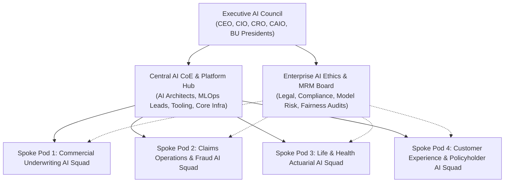
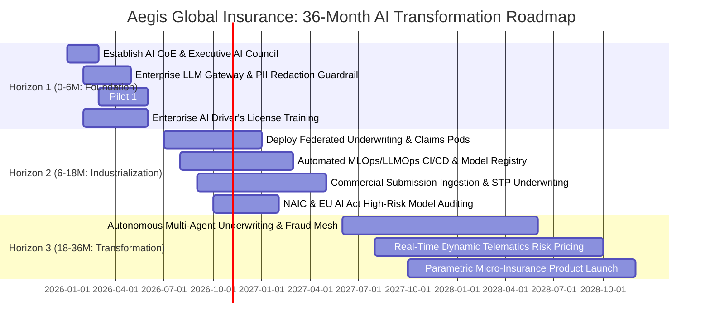
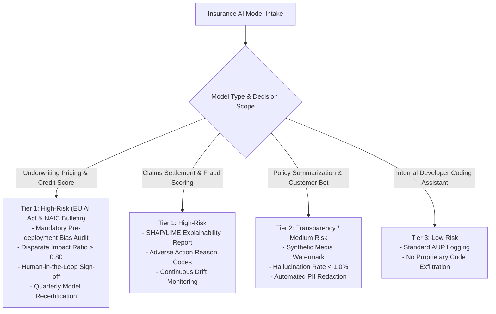

# Enterprise AI Strategy, Capability Transformation & Governance Roadmap
## Aegis Global Insurance Group: 36-Month AI Transformation Masterplan

---

## Document Metadata
* **Enterprise**: **Aegis Global Insurance Group** (Tier-1 Composite Carrier)
* **Industry**: Insurance (Property & Casualty, Life & Health, Commercial & Reinsurance)
* **Target Operating Horizon**: 2026 – 2028 (36 Months)
* **Sponsoring Executives**: Group Chief Information Officer (CIO), Chief Risk Officer (CRO), Interim Chief AI Officer (CAIO)
* **Document Version**: 1.0 (Executive Board Baseline)

---

## 1. Executive Summary & Strategic Ambition

### 1.1 The North Star AI Vision
> **"To transform Aegis Global Insurance into a predictive, automated, and AI-augmented composite carrier—empowering our underwriters, adjusters, and actuaries with cognitive AI co-pilots while enforcing zero-trust model governance, ensuring regulatory compliance, and driving $85M+ in net annual bottom-line value."**

### 1.2 Enterprise AI Ambition Matrix
| Ambition Tier | Strategic Focus | Target Business Impact | Representative Insurance Capabilities | Target Capital Allocation (%) |
| :--- | :--- | :--- | :--- | :---: |
| **Tier 1: Core Optimization** | Operational Efficiency & Cost Reduction | 20–35% reduction in claims processing expense & LAE | Multimodal FNOL extraction, claims triaging, medical bill review, policy doc summarization | **40%** |
| **Tier 2: Expanded Capabilities** | Revenue Growth & Speed-to-Market | 12x faster commercial underwriting turnaround | Dynamic risk scoring, broker submission ingestion, telematics driving models | **35%** |
| **Tier 3: Business Model Transformation** | Autonomous Underwriting & Market Disruption | Net-new parametric and micro-insurance lines | Autonomous micro-claims settlement, continuous AI risk underwriting, agentic fraud defense | **25%** |

---

## 2. Enterprise AI Target Operating Model (TOM) & RACI

### 2.1 Selected Operating Model: Federated Hub-and-Spoke
To balance strict regulatory compliance across NAIC/EU jurisdictions with localized agility across business units, Aegis adopts a **Federated Hub-and-Spoke AI Operating Model**.

* **Central Platform Hub (Enterprise AI CoE)**: Standardizes enterprise LLM gateways, vector databases, MLOps/LLMOps CI/CD pipelines, enterprise model registry, and governance guardrails.
* **Business Unit Spokes (Cross-Functional AI Pods)**: Embedded cross-functional squads inside P&C Commercial Underwriting, Claims Operations, and Life & Health actuarial teams to build domain-specific workflows.

### 2.2 Enterprise Governance & Delivery Topology


### 2.3 Executive RACI Matrix
| Function / Role | AI Strategy & Budget | Use Case Intake | Platform & Infra | Model Dev & Tuning | Model Risk & Governance | MLOps Deployment | Change & Literacy |
| :--- | :---: | :---: | :---: | :---: | :---: | :---: | :---: |
| **Chief AI Officer (CAIO) / CDAO** | **A / R** | **A** | **C** | **I** | **A** | **I** | **A** |
| **Executive AI Council** | **C** | **A** | **I** | **I** | **A** | **I** | **C** |
| **BU Presidents (Underwriting / Claims)** | **C** | **R** | **I** | **C** | **I** | **I** | **R** |
| **Central AI CoE / Lead Architect** | **R** | **C** | **A / R** | **C** | **R** | **A / R** | **C** |
| **Embedded AI Pod Engineers** | **I** | **C** | **C** | **A / R** | **C** | **R** | **I** |
| **Model Risk Management (MRM) & Legal** | **C** | **I** | **C** | **I** | **A / R** | **C** | **I** |
| **HR / AI Literacy Guild** | **I** | **I** | **I** | **I** | **I** | **I** | **A / R** |

*R = Responsible, A = Accountable, C = Consulted, I = Informed*

---

## 3. AI Capability Maturity Assessment (ACMA) & Gap Analysis

### 3.1 Maturity Scorecard (0.0 to 5.0 Scale)

$$\text{Overall Maturity Score} = \sum_{i=1}^{6} (\text{Pillar Score}_i \times \text{Weight}_i)$$

| Capability Pillar | Weight | Current Score | Target (12M) | Target (36M) | Identified Gaps & Remediation |
| :--- | :---: | :---: | :---: | :---: | :--- |
| **1. Strategy & Executive Alignment** | 15% | **1.5** | **3.5** | **4.8** | Stalled POCs; establish formal CAIO office, AI charter, and stage-gate funding. |
| **2. Data Foundation & Semantic Mesh** | 20% | **1.2** | **3.0** | **4.6** | 14 siloed DBs; deploy insurance lakehouse, entity resolution, and vector DB for policies. |
| **3. AI Platform & MLOps Infrastructure** | 20% | **1.0** | **3.2** | **4.7** | Manual model hosting; deploy enterprise LLM gateway, automated CI/CD, and eval pipelines. |
| **4. Talent, Organization & Culture** | 15% | **1.0** | **3.0** | **4.5** | High replacement anxiety; deploy 4-tier literacy tracks and recruit 70+ AI champions. |
| **5. Governance, Ethics & Model Risk** | 15% | **1.3** | **3.8** | **4.9** | Active Shadow AI; enforce AUP, automated PII redaction, NAIC/EU AI Act compliance. |
| **6. Use Case Pipeline & Value Realization** | 15% | **1.4** | **3.4** | **4.7** | Lack of value tracking; standardize intake qualification and ROI dashboards. |
| **Weighted Composite Maturity** | **100%** | **`1.22` (Ad-Hoc)** | **`3.30` (Operational)** | **`4.71` (AI-Native)** | **Full institutional transformation to an AI-Augmented Carrier** |

---

## 4. Multi-Horizon Enterprise AI Transformation Roadmap



### 4.1 Workstream Breakdown
* **Horizon 1 (Months 0–6: Foundation & Safe Containment)**:
  * Deploy centralized Enterprise LLM Gateway (Azure OpenAI / AWS Bedrock) with automated PII scrubbing (Presidio).
  * Publish Acceptable Use Policy (AUP) to eliminate unmonitored Shadow AI.
  * Deliver Quick Win: Claims Multimodal FNOL Extractor (cutting FNOL intake from 45 min to 90 seconds).
* **Horizon 2 (Months 6–18: Industrialization & Scale)**:
  * Deploy Commercial Underwriting Co-Pilot (automating ACORD parsing, loss run extraction, and rating sheet prep).
  * Establish enterprise Model Risk Management (MRM) platform with automated fairness/bias checks.
  * Roll out Track 2 & 4 technical and business training programs.
* **Horizon 3 (Months 18–36: Autonomous Transformation)**:
  * Deploy Multi-Agent Claim Settlement Mesh for instant micro-claim payouts ($< \$2,500$).
  * Launch real-time dynamic pricing for commercial fleet telematics.

---

## 5. Enterprise AI Governance, Ethics & Model Risk Management (MRM)

### 5.1 Regulatory Compliance Mapping



### 5.2 3-Lines of Defense in Insurance AI
* **1st Line (Delivery Pods)**: Feature engineering, data hygiene, prompt testing, unit-level guardrails.
* **2nd Line (MRM & Ethics Committee)**: Independent model validation, demographic parity audits, algorithmic risk tiering, vendor AI risk assessments.
* **3rd Line (Internal Audit)**: Annual governance compliance reviews and board reporting.

### 5.3 Automated Safety & Kill-Switch Safeguards
* **Automated Guardrail Fail-Safe**: If hallucination or toxicity rate exceeds `1.5%`, requests immediately failover to deterministic business rules in Guidewire.
* **Underwriter Override Record**: Every AI-suggested risk score or claim payout recommendation can be overridden by a human underwriter with recorded rationale, feeding the continuous reinforcement loop.

---

## 6. Organizational Change Management (OCM) & AI Literacy Program

### 6.1 ADKAR Change Implementation
* **Awareness**: C-suite roadshow positioning AI as a **"Cognitive Multiplier"** to eliminate manual PDF reading, not replace underwriters.
* **Desire**: Career path upgrades: "Junior Underwriter" $\rightarrow$ "AI-Augmented Portfolio Underwriter".
* **Knowledge**: 4-Tier structured curriculum across 14,000 employees.
* **Ability**: Safe enterprise sandbox environments with guided prompt libraries.
* **Reinforcement**: Annual "Aegis AI Innovation Cup" and recognition bonuses for high-performing AI pod champions.

### 6.2 4-Tier Persona-Based Training Curriculum
| Track | Audience | Cohort Size | Duration & Format | Core Competency Acquired |
| :--- | :--- | :---: | :--- | :--- |
| **Track 1: Leadership** | C-suite, SVPs, Managing Underwriters | ~120 | 1-Day Workshop + Quarterly Clinics | AI governance, capital allocation, risk appetite, ROI tracking |
| **Track 2: Business & Product** | Product Owners, Actuaries, Lead Adjusters | ~850 | 3-Week Hybrid Bootcamp | Use case qualification, prompt crafting, HITL design, model evals |
| **Track 3: Workforce / Citizen AI** | All Underwriters, Claims Handlers, Support | ~11,000 | 6-Hour Self-Paced LMS + Prompt Labs | Enterprise AI Driver's License, safe LLM usage, PII hygiene |
| **Track 4: Technical & ML** | Data Scientists, Software/Cloud Engineers | ~450 | 8-Week Deep-Dive + Hackathons | RAG pipelines, MLOps CI/CD, red-teaming, agentic orchestration |

---

## 7. Balanced Scorecard & Value Realization Telemetry

### 7.1 Balanced Transformation Scorecard
| Dimension | Key Performance Indicator (KPI) | Current Baseline | 12-Month Target | 36-Month Target |
| :--- | :--- | :---: | :---: | :---: |
| **Financial Value** | Net Realized Value (Expense Reduction + Fraud Savings) | `$0` | **`$24.5M`** | **`$86.2M`** |
| **Underwriting Speed** | Commercial Underwriting Turnaround Time (TAT) | `12 Business Days` | `3 Business Days` | `< 24 Hours` |
| **Claims Velocity** | Average Settlement Turnaround Time | `18 Days` | `6 Days` | `< 3 Days` |
| **Straight-Through-Processing** | Low-Risk Claim Straight-Through Processing (% STP) | `< 5%` | `35%` | `75%` |
| **Capability Maturity** | Composite ACMA Score (0–5 Scale) | `1.22 (Ad-Hoc)` | `3.30 (Operational)` | `4.71 (AI-Native)` |
| **Workforce Adoption** | Monthly Active AI Users (% Total Employees) | `< 8% (Sanctioned)` | `60%` | `> 90%` |
| **Model Risk & Safety** | Zero High-Risk Regulatory or Privacy Breaches | 100% | 100% | 100% |

---

## 8. 90-Day Immediate Action Plan (Quick-Win Execution)

```
[ Days 1–30: Governance, Security & Immediate Containment ]
  ├── Charter the Executive AI Council & Appoint Interim CAIO
  ├── Publish Enterprise AI Acceptable Use Policy (AUP) to curb Shadow AI
  └── Deploy Enterprise LLM Gateway with Presidio PII scrubbing

[ Days 31–60: Platform Foundation & Pilot Kickoff ]
  ├── Launch Track 1 (Executive) and Track 3 (Workforce) "AI Driver's License"
  ├── Complete baseline ACMA audit across all 14 database silos
  └── Kick off Pilot 1: Claims FNOL Multimodal Document Extraction Squad

[ Days 61–90: Pilot Delivery & Operating Model Rollout ]
  ├── Deliver Pilot 1 to production in Guidewire ClaimCenter (TAT reduced by 85%)
  ├── Establish Model Risk Management (MRM) pre-deployment validation gates
  └── Form the Aegis AI Champion Network (70 initial champions recruited)
```
