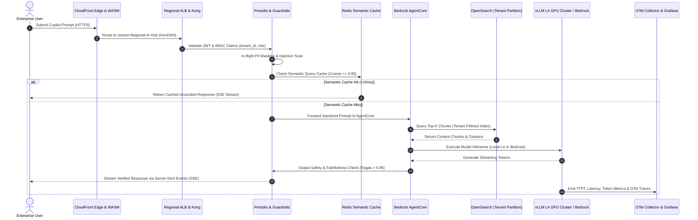

# Multi-Region Enterprise SaaS AI Platform — System Architecture & Design

**Target Sector**: Global Enterprise B2B SaaS  
**Scope**: High-Availability, Low-Latency Multi-Region AI Copilot Infrastructure (5 Global Regions)  
**Cloud Platform**: Amazon Web Services (AWS)  
**Scale**: 50M+ Global Users, 3x Seasonal Traffic Spikes, Sub-150ms P99 Latency SLA, Zero Cross-Tenant Data Leakage  

---

## 1. AI Problem Classification
- **Domain**: Enterprise Generative AI Copilot & Multi-Tenant Retrieval-Augmented Generation (RAG).
- **Workload Types**:
  1. **Interactive Real-Time Dialogue & Copilot Assist**: Sub-150ms first-token latency, streaming responses via Server-Sent Events (SSE).
  2. **Multi-Tenant Document & Knowledge Retrieval (RAG)**: Dense and sparse hybrid semantic search across private enterprise documents with Row-Level Security (RLS).
  3. **Multi-Agent Task Orchestration & Tool Execution**: Bedrock AgentCore supervisor decomposing complex enterprise user intents into multi-step DAG tool invocations (CRM, ERP, sandboxed code execution).
  4. **Asynchronous Fine-Tuning & Model Training**: Parameter-Efficient Fine-Tuning (PEFT / LoRA) and batch vector embeddings running on cost-optimized 60% spot compute pools.

---

## 2. Architecture Pattern Selection

| Layer / Requirement | Selected Pattern | Architecture Rationale |
|---|---|---|
| **Inference Serving** | **Hybrid Multi-Tier Serving (vLLM on L4/Graviton + Bedrock API)** | Local vLLM engines running on AWS G6 (NVIDIA L4) and Inferentia2 instances deliver ultra-low latency (<150ms TTFT) for 70% of standard copilot tasks; complex multi-step reasoning cascades to Amazon Bedrock (Claude 3.5 Sonnet). |
| **Agent Orchestration** | **Bedrock AgentCore Supervisor + Sandboxed Workers** | Enables structured goal decomposition, dynamic tool routing, short-term session state preservation (DynamoDB Global), and isolated Firecracker microVM execution for generated code. |
| **Retrieval Architecture** | **Hybrid Multi-Tenant Dense/Sparse RAG + Reranking** | OpenSearch Serverless with k-NN HNSW vector indexing partitioned by `tenant_id`, combined with Cohere/BGE rerankers on Inf2 instances for >92% context recall. |
| **Cost Optimization** | **Semantic Cache + Model Tiering + 60% Spot Compute** | Multi-region ElastiCache Redis stores embeddings of prior queries (Cosine similarity ≥ 0.95 yields <15ms hits at $0 LLM cost); asynchronous training/fine-tuning leverages Karpenter-managed AWS Trainium/H100 spot fleets. |
| **Tenant Isolation** | **Cryptographic ABAC & Row-Level Security (RLS)** | Tenant-specific AWS KMS Customer Managed Keys (CMKs), PostgreSQL RLS on Aurora Global, and Cedar/OPA ABAC policy evaluation at API gateway prevent cross-tenant data leakage. |

---

## 3. Architecture Reasoning & Technology Decisions

1. **Amazon EKS (Kubernetes 1.30) with Karpenter & KEDA**:
   - Karpenter enables sub-60s node provisioning with direct GPU bin-packing across Spot (Trainium/H100) and On-Demand (G6 L4/Inf2) instances.
   - KEDA scales inference pod replicas directly based on queue depth and custom Prometheus metrics (e.g., `vllm_num_requests_waiting`), eliminating cold starts during 3x traffic surges.
2. **Warm Pool Architecture**:
   - Pre-warms 20% buffer GPU capacity with model weights pre-loaded into VRAM, absorbing immediate traffic surges without waiting for image pulls or weight deserialization.
3. **ElastiCache Redis Semantic Prompt Caching**:
   - Computes query embeddings at the edge and matches against semantic cache before invoking inference engines, eliminating ~40% of redundant LLM token costs.
4. **AWS Control Tower & Organizations with Transit Gateway**:
   - Enforces multi-account governance with dedicated core, security, and regional workload accounts interconnected via multi-region AWS Transit Gateway peering.

---

## 4. AI System Context

| Property | Specification / Target |
|---|---|
| **Business Objective** | Global real-time GenAI copilot services for 50M+ users across 5 regions |
| **Inference Latency SLA** | **< 150 ms** P99 TTFT (Time to First Token) |
| **Availability SLA** | **99.95%** Regional & Global Uptime |
| **Cost Optimization Target** | **~60% Spot instance utilization** for batch & training workloads; ~40% token cache hit rate |
| **Tenant Isolation & Security** | Zero cross-tenant data leakage; SOC2 Type II & ISO 27001 compliant |
| **Traffic Scalability** | **3x seasonal surges** handled without latency degradation |
| **Global Deployment** | 5 Regional AI Hubs: `us-east-1` (US-East), `us-west-2` (US-West), `eu-west-1` (Europe), `ap-southeast-1` (Singapore), `ap-northeast-1` (Tokyo) |

---

## 5. Architecture Components (8 Enterprise Layers)

```
┌──────────────────────────────────────────────────────────────────────────────────────┐
│ 1. USER & INGRESS LAYER: Web Portal (Next.js), Mobile App, Slack/Teams, API Clients   │
├──────────────────────────────────────────────────────────────────────────────────────┤
│ 2. APPLICATION & EDGE LAYER: CloudFront CDN, WASM Edge Routers, Route 53 (GeoDNS)    │
├──────────────────────────────────────────────────────────────────────────────────────┤
│ 3. API & SECURITY GATEWAY: Regional ALBs, IAM Identity Center (ABAC), Presidio PII   │
├──────────────────────────────────────────────────────────────────────────────────────┤
│ 4. AI AGENT & ORCHESTRATION: Bedrock AgentCore, Multi-Agent Workers, Semantic Cache   │
├──────────────────────────────────────────────────────────────────────────────────────┤
│ 5. COMPUTE & INFERENCE FLEET: EKS (vLLM on L4 / Inf2), Warm Pools, Spot Trainium    │
├──────────────────────────────────────────────────────────────────────────────────────┤
│ 6. DATA & VECTOR STORAGE: OpenSearch Vector Serverless, Aurora Global DB, S3 Tables │
├──────────────────────────────────────────────────────────────────────────────────────┤
│ 7. INFRASTRUCTURE & MESH: Multi-Region VPCs, AWS PrivateLink, Transit Gateway Mesh   │
├──────────────────────────────────────────────────────────────────────────────────────┤
│ 8. OBSERVABILITY & GOVERNANCE: OpenTelemetry, Prometheus, Grafana, TruLens / Ragas   │
└──────────────────────────────────────────────────────────────────────────────────────┘
```

---

## 6. End-to-End Interaction Flow



---

## 7. Draw.io Architecture Diagrams Breakdown (10 Dedicated Views)

The comprehensive architecture diagrams are packaged in [`multi_region_saas_ai_platform.drawio`](file:///lab-ai-system-designs/saas-ai-platform/multi_region_saas_ai_platform.drawio) with 10 distinct, importable pages:

1. **Logical Architecture View (`LogicalView`)**: Full omnichannel ingress, security gateway, Bedrock AgentCore orchestration, model serving pools, tiered storage, and observability layers.
2. **Infrastructure Architecture View (`InfraView`)**: Global AWS Control Plane, 5 Regional Hub VPCs (`us-east-1`, `eu-west-1`, `ap-southeast-1`, `ap-northeast-1`, `us-west-2`), EKS clusters, Karpenter GPU node pools, and Transit Gateway mesh.
3. **Security Architecture View (`SecurityView`)**: Zero-trust perimeter, IAM Identity Center ABAC, NeMo / Bedrock guardrails, Presidio PII anonymization, KMS tenant CMKs, and SOC2 / ISO 27001 compliance audit trails.
4. **Observability, Logging & Monitoring View (`ObservabilityView`)**: Cloud-Agnostic Dual-Tier OTel Gateway, Observe Inc. unified log/trace backend with OPAL dataset modeling, Obstack Prometheus TSDB for high-cardinality metrics, TruLens / Ragas ML evaluation, and P99 latency SLA dashboards (<150ms) spanning Customer Journey, Business, App/GenAI, and Infrastructure metrics.
5. **MLOps / LLMOps CI/CD Pipeline View (`CicdView`)**: GitHub Actions CI with automated prompt evaluation benchmarks, Trainium/H100 60% spot LoRA fine-tuning, MLflow model registry, and ArgoCD / Flagger progressive canary rollouts.
6. **Data Lineage & Privacy Governance View (`DataPrivacyView`)**: Document chunking, PII hashing, tenant-partitioned vector indexing, AWS DataZone lineage provenance, and automated GDPR "Right to be Forgotten" purge workflows.
7. **Resilience, HA & Multi-Provider Fallback View (`ResilienceView`)**: Multi-region Route 53 failover (<15s), Circuit breaker cascading (Tier 1: Local vLLM L4 → Tier 2: Bedrock Claude 3.5 → Tier 3: Quantized Llama-3 8B), and warm pool surge dampening.
8. **Multi-Agent Orchestration & Tool Execution View (`MultiAgentView`)**: Bedrock AgentCore supervisor, specialized worker agents (RAG, SaaS API, Code generation), Firecracker microVM sandboxing, and DynamoDB global state management.
9. **FinOps & Semantic Cache Cost Optimization View (`FinOpsView`)**: Redis semantic cache (<15ms hit), tiered query complexity classification, Karpenter GPU bin-packing, 60% spot training, and tenant-level token allocation.
10. **AI Model Governance, Safety & HITL Evaluation View (`GovernanceHITLView`)**: Real-time Ragas grounding verification (>0.85 threshold), automated HITL escalation queue in Amazon A2I, and continuous DPO/RLHF feedback loops.

---

## 8. Multi-Region Infrastructure Specifications

```
                          AWS Global Route 53 (GeoDNS)
                                      │
           ┌──────────────────────────┼──────────────────────────┐
           ▼                          ▼                          ▼
   ┌───────────────┐          ┌───────────────┐          ┌───────────────┐
   │ Regional Hub  │          │ Regional Hub  │          │ Regional Hub  │
   │  US-East-1    │          │  EU-West-1    │          │ APAC-SG/Tokyo │
   │ (Americas)    │          │ (Europe-GDPR) │          │ (Asia-Pac)    │
   ├───────────────┤          ├───────────────┤          ├───────────────┤
   │ • EKS GPU L4  │          │ • EKS GPU L4  │          │ • EKS GPU L4  │
   │ • Inf2 Fleet  │          │ • OpenSearch  │          │ • OpenSearch  │
   │ • OpenSearch  │          │ • Aurora Rep  │          │ • Redis Cache │
   │ • Aurora Prim │          │ • Redis Cache │          │ • FSx Local   │
   │ • FSx Lustre  │          │ • EU KMS CMK  │          │ • Latency:    │
   │ • Trainium    │          │ • Sovereign   │          │   <120ms      │
   └───────────────┘          └───────────────┘          └───────────────┘
```

---

## 9. Operational Model & Enterprise Governance

| Dimension | Policy / Specification |
|---|---|
| **Service Level Agreement (SLA)** | 99.95% Availability; P99 Inference Latency < 150ms |
| **Disaster Recovery (DR)** | Active-Active multi-region with Route 53 automated health checks; RPO < 1 min, RTO < 15 mins |
| **Backup & Retention** | Continuous Aurora point-in-time recovery (35 days); S3 Versioning + S3 Glacier Vault for audit logs (7 years) |
| **FinOps Governance** | Automated per-tenant token budgeting, nightly GPU idle teardown, 60% spot target for training |
| **Security Certification** | SOC2 Type II, ISO 27001, GDPR Article 17 Purge Automation, HIPAA BAA Ready |

---
